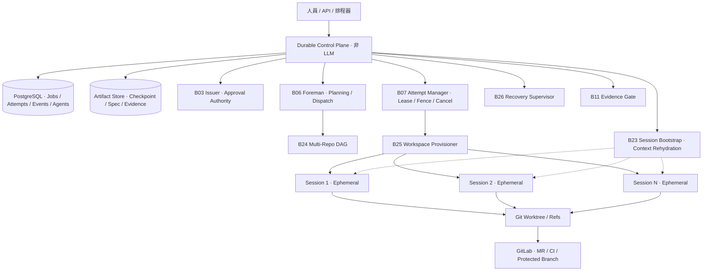
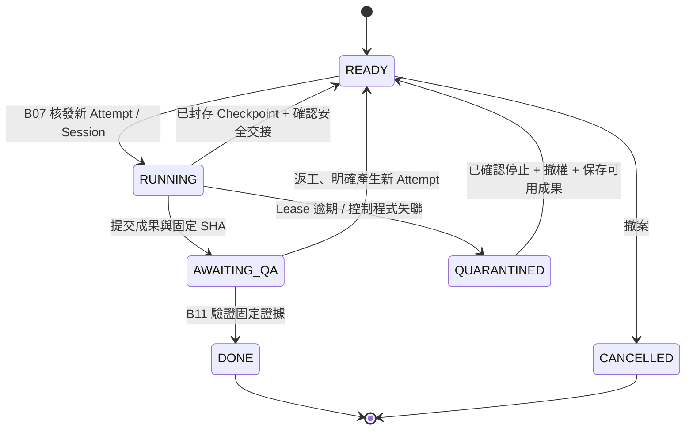
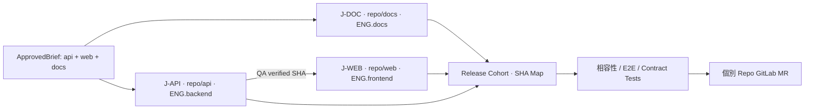

# Durable Agent Runtime — Agent Session 可終止、任務可接續、跨 Repo 協作

> v0.2 · 2026-10-21 · Agent LEGO 擴充規格。**規格與 SQLite 參考實作／模擬測試，不是已部署的生產級 Agent Runtime。**
>
> 對應既有 `LEGO_WORKFLOWS.md`：新增 **B22–B26**，保留 B06 Foreman / B07 Attempt Manager 的唯一責任，不啟動第二個工頭。

## 1. 目標與驗收

**需求：** Agent Session 可以結束，但任務、邏輯身分、進度、工作產物與授權歷史必須跨 Session、跨程序重啟保存；可同時管理多個 Git Repository、獨立 Worktree、平行任務、依賴 DAG、失聯後的安全恢復。

### 驗收定義

| 條件 | 判定方式 |
|---|---|
| S1 任務持久化 | 控制程式關閉重啟後，`Job`、Attempt、事件及 Checkpoint 可重新查詢 |
| S2 身分持久化 | `agent_id` + `role_id` / 釘選版本不依賴 `session_id`；新 Session 不自動取得舊權限 |
| S3 可接續 | 工作已儲存有效 Checkpoint；舊執行權撤銷後，新 Attempt 取得精簡恢復封包繼續工作 |
| S4 舊結果失效 | 逾時、交接或重試後的舊 `attempt_id` / `fence_generation`，即使報 PASS 也拒收 |
| S5 平行工作 | 兩個沒有依賴關係的 Job 可同時領取；每個 Attempt 的工作區彼此隔離 |
| S6 跨 Repo | Job 綁定 Repo ID、base SHA、允許路徑與依賴；後續 Repo 的 Job 必須等待前置 QA 完成 |
| S7 安全清理 | Worker 未確認退出時，狀態維持 `QUARANTINED`，禁止重複寫入與刪除工作區 |
| S8 證據可靠 | Review/QA 綁固定 SHA、Repo，只有可信 Gate 可由 `AWAITING_QA` 推進為 `DONE` |
| S9 恢復不越權 | 恢復前重新確認 ApprovedBrief、Role 能力、Repo 權限、預算與 Skill/Config 版本 |
| S10 組織恢復 | 多個 Session 全部結束，工頭仍可從 DB 找到 Ready、Blocked、Pending QA、Quarantined 等工作 |

**非目標：** 不中斷複製 LLM 的內部推理狀態；不假設 Agent Session 本身擁有持久生命；不保證跨多個 Git Repo 的原子交易；不將聊天記錄當成任務資料庫。

## 2. 正式分層：Runtime 不是 Chat



**Source of truth：** PostgreSQL 儲存可交易的狀態與事件；Artifact Store 保存大文件與 Checkpoint；Git Repo 儲存程式碼、Commit、Branch、MR；Secret Manager 提供短效憑證。**LLM 對話內容不是 authoritative state。**

M0 可以使用**單一控制程式 + PostgreSQL + 背景 Worker**，以資料庫交易領任務，不必急著引入 Kafka、Kubernetes 或多個微服務。SQLite 在附件中只用於離線契約驗證。

## 3. 新增五塊 LEGO 積木

| 模組 | 唯一責任 | 所有者（非 LLM 或限制範圍的 Agent） | 依賴 | 階段 |
|---|---|---|---|---|
| **B22 Durable State Store** | 交易狀態、事件、Checkpoint 索引、Agent Registry | 非 LLM State API | B03/B07 資料契約 | M0，第一優先 |
| **B23 Identity & Session Bootstrap** | 固定 Agent 邏輯身分、組裝新 Session 恢復上下文 | Runtime bootstrap 程式 | B22 + Issuer + Registry | M0 |
| **B24 Multi-Repo Coordinator** | 持有跨 Repo 工作 DAG 與版本相容性清單；將可執行節點提交給 B06 | 非 LLM DAG Controller | B22、B06、B09 | M1 |
| **B25 Workspace Provisioner** | 依 Attempt 建立 Worktree／隔離環境、暫存成果、收尾封存 | 非 LLM Workspace Controller | B07、Git、Artifact Store | M0 單 Repo；M1 多 Repo |
| **B26 Recovery Supervisor** | 偵測失聯並向 B07 發送撤權／取消／重新派工事件；掃描異常狀態 | 非 LLM Reconciler | B22、B07、B25 | M0 |

**權限分離：** B26 不能自己重新核發 Attempt 或宣稱 Worker 已退出；這仍由 B07 管理並取得 B25 的可信結束證明。B24 不能繞過 B06 直接派工。B23 不得根據記憶創造授權。

### 舊模組接點

- **B03 Issuer**：持久化 ApprovedBrief，綁 `issuer_id`、`scope_ids`、`repo_ids`、`allowed_operations`、有效期限及預算。新的 Attempt 必須重新驗證可用授權。
- **B06 Foreman**：唯一 Job lifecycle Owner，負責 DAG frontier 排程與模型／成本路由。從 B22 讀寫持久任務，而非依賴聊天狀態。
- **B07 Attempt Manager**：唯一 Attempt lifecycle Owner，負責 Lease、Fencing、重試、撤權、取消與工作區回收順序。
- **B09 Git Integrator**：只整合已授權 Repo 的有界 Commit，不能啟動 `implement-spec`。
- **B10 QA Coordinator**：每一個固定 diff 只啟動一次完整兩軸 `code-review`；交接只傳 Evidence refs。
- **B11 Evidence Gate**：對 GitLab API / CI 原始證據與固定 SHA 做實際驗證；一段 `PASS` 字串不代表通過。

## 4. 不可混淆的五種身分

| 名詞 | 是否持久 | 用途 | 失效／更換時 |
|---|---|---|---|
| `role_id` | 持久配置 | 哪個職務可以執行哪類行為（例如 `ENG.backend`） | 角色版本化，權限由政策另行授予 |
| `agent_id` | 持久邏輯 ID | 一個可追蹤的角色任用／長期工作者；非模型實例 | 同一 Agent 可跨 Session 恢復，仍需重新認證 |
| `session_id` | 生命短暫、紀錄持久 | 一次 LLM 執行／會話 | Session 結束即不可再提交動作 |
| `job_id` | 持久 | 一件業務／工程工作 | 不隨 Session 終止消失 |
| `attempt_id` + `fence_generation` | 每次執行新建，歷史持久 | 排他寫入、重試、舊結果隔離 | 恢復＝新 Attempt；前一次權限作廢 |

**Skill 不是身分，Role 不是 Authority。** Role 對應 Agency Profile；Skill 對應工程方法；Runtime 決定 Session／工具；非 LLM Issuer 和控制程式決定操作授權。

## 5. 外部保存哪些資訊

| Source | 保存內容 | 不應保存／注意 |
|---|---|---|
| PostgreSQL | Jobs、DAG 邊、Agents、Sessions、Attempts、狀態、租約、Fence、預算、事件、Artifact 索引 | 不保存 API Token 原文或巨大聊天逐字稿 |
| 物件儲存／Artifact Store | Spec、Ticket、Evidence Manifest、可恢復 Checkpoint、測試 log、補丁快照 | 必須 hash、版本化、可追溯，寫入完成才記錄 ref |
| Git Repository | Repo ID／Remote、固定 base SHA、Branch、Commit、MR、CI | 不把未 Commit 的 Worktree 假定為持久內容 |
| Agent Registry | `agent_id`、Role、Profile/Skill 的 pin SHA、能力要求、執行政策 | 不把 Profile 內的文字當成權限授權 |
| Secret Manager | 每 Attempt 有時效與 Repo 範圍的憑證 | 不流入 Agent Checkpoint、A2A、Log |

**進度應該是有證據的進度**：例如 `spec_version`、`tests_red_ref`、`commit_sha`、`CI pipeline_id`、`remaining_ticket_ids`，不建議採用 Agent 主觀估算的百分比作為排程依據。

## 6. 核心持久化契約

- [`contracts/durable-session.schema.json`](contracts/durable-session.schema.json)：Agent 邏輯身分與 Session／Attempt 綁定。
- [`contracts/durable-checkpoint.schema.json`](contracts/durable-checkpoint.schema.json)：跨 Session 工作狀態，包含已完成／待執行、Repo SHA、Artifact refs，**不包含秘密或原始推理**。
- [`contracts/multi-repo-plan.schema.json`](contracts/multi-repo-plan.schema.json)：跨 Repo DAG 與整合批次（Release Cohort）的版本清單。
- 既有 [`contracts/job-attempt.schema.json`](contracts/job-attempt.schema.json) 與 [`a2a-compact/message.schema.json`](a2a-compact/message.schema.json) 仍是 B07 和 A2A v2 的權威契約；不可建立競爭版本。

**驗證分層：** JSON Schema 只檢查物件結構；B24 必須額外以程式檢查 Repo/Job ID 唯一、依賴節點存在與 DAG 無循環（參考 `durable-runtime/validate_plan.py`）。Scope/Approval 還必須交給 B03/B05 的授權政策驗證。

**交易原則：** `Job` 更新 + `Event Log` 應在同一個 DB Transaction；領取任務使用 Row Lock / `FOR UPDATE SKIP LOCKED` 或 CAS；任務狀態修改需驗證目前 Attempt / Fence。外部 GitLab API、CI Trigger、Artifact 寫入則用 `idempotency_key` + transactional outbox、回讀確認結果；不能宣稱跨 DB 和 GitLab 有 Exactly Once。

### Context Rehydration 封包

新 Session **不需要原聊天**，它拿到經 B23 驗證後的精簡資料：

```json
{
  "agent_id": "agent-backend-1",
  "role_id": "ENG.backend",
  "session_id": "session-new",
  "job_id": "J-API",
  "attempt_id": "A-0002",
  "fence_generation": 2,
  "approved_brief_ref": "brief://approved-1",
  "spec_ref": "artifact://spec-v3",
  "checkpoint_ref": "artifact://checkpoint-J-API-v4",
  "repo": {
    "repo_id": "repo://api",
    "base_sha": "aaaaaaaaaaaaaaaaaaaaaaaaaaaaaaaaaaaaaaaa",
    "worktree_ref": "workspace://J-API/A-0002"
  },
  "next_action": "重新執行失敗的 API 測試並實作最小修正",
  "required_skill_refs": ["matt/tdd@pinned", "ponytail@pinned"],
  "proof_required": ["test_ref", "commit_sha"]
}
```

這個物件是**經控制程式編譯的執行封包**，不是從舊 Session 的自由敘事推測。工作要能完整接續，須持久保存實際檔案狀態（commit / patch / artifact），不能只寫「做到一半」。

## 7. 任務／Session／Attempt 狀態機



- **Graceful stop**：先寫入有效 Checkpoint、封存資料，撤除前一個 Session／Attempt 的執行權，再關閉 Session；之後建立全新 Attempt 繼續。
- **意外崩潰**：Supervisor 發現心跳／Lease 過期，B07 使 Attempt 失效，先進入 `QUARANTINED`；B25 確認容器／程序樹退出並封存資料後才解除隔離。
- **控制程式重啟**：掃描 DB：`READY` 重新排程；`RUNNING` 依 Lease 判定；`QUARANTINED` 必須繼續確認停止，不能自行視為乾淨；`AWAITING_QA` 重新核對證據，不必再啟動 Coding Agent。
- **重試上限**：由 B07/B06 依 policy 設定；同樣的錯誤不盲目重跑。`TIMED_OUT` 是執行問題，不等於商業否決。

### 明確的停止協定

1. DB CAS 使舊 Attempt 的**結果提交權**失效，禁止接受過期 Output。
2. 撤銷 Worker 寫入憑證、阻擋 GitLab push/MR 更新與 Artifact promotion；不能只有 DB Fencing。
3. 向受管理的程序／容器送取消訊號，確認子程序全部結束。
4. 未能證明退出時維持 `QUARANTINED`，工作區和外部副作用保持隔離，不建立可與舊工作區競爭寫入的 Worker。
5. 保存最後可信成果／補丁，按 hash 寫入 Artifact Store。
6. 確認安全後才清理 Worktree／啟動新的 Attempt。

**重要限制：** 不能只靠新的 `fence_generation` 阻止舊 Worker 對 Git remote 的直接 push；必須由 GitLab 權限、短效 Credential、Push Gateway／受保護分支或隔離 Runner 保證外部副作用可控。

## 8. Multi-Repo：工作樹、依賴與整合



**執行規則：**

1. B24 把一個 ApprovedBrief 分解為 `repo_id` + `base_sha` + allowed path + ticket dependency 的 DAG；每個 Repo 各有可審核 Branch／MR。
2. 不依賴的 Job 並行；有依賴的 Job 必須等上游**固定 SHA 的 QA Gate 成功**，不能以 Agent 口頭 `DONE` 放行。
3. B25 每個 Attempt 使用獨立 Worktree／容器；同 Repo 並行允許，但不得共享可寫入目錄。整合分支只由 B09 有界操作更新，衝突須回報並重新審查。
4. 跨 Repo 完成一個 `Release Cohort Manifest`，列出每個 Repo 的確切 SHA、契約版本、CI 與整合測試 Evidence；任一 SHA 改變須重驗受影響路徑。
5. **Git Repository 間沒有原子 Commit／Merge。** 若要跨 Repo 一起發布，使用相容性發布順序、Feature Flag、Staged Rollout 或補償式回滾（Saga），不得宣稱多 MR 能原子合併。
6. 從 GitLab 讀取目前遠端 Branch SHA 與期待的 `base_sha` 比對；基底移動或被他人修改時停止並 Rebase／重新驗證，不直接覆蓋遠端。

### 跨 Repo 的 ownership 範例

| Job | Repo | 前置任務 | Role / Skill | 可寫範圍 |
|---|---|---|---|---|
| `J-API` | `repo://api` | 無 | Backend Architect / Matt `tdd` | `src/api/**` |
| `J-DOC` | `repo://docs` | 無 | Technical Writer / `writing-for-agents` | `docs/**` |
| `J-WEB` | `repo://web` | `J-API` QA 通過 | Frontend Developer / Matt `tdd` + Ponytail | `app/**` |
| Cohort Check | 全部（唯讀） | API、DOC、WEB | QA Coordinator / evidence gate | 不得修改 source |

## 9. Agent-to-Agent 通訊與可恢復進度

A2A 一律使用既有 v2 的 `job_id + attempt_id + fence_generation`；**詳細資料寫 Artifact Store，訊息僅送 refs**。

```json
{
  "v": "2", "type": "RESULT", "job_id": "J-API",
  "attempt_id": "A-0002", "fence_generation": 2,
  "state": "DONE", "artifact_refs": ["git://api/aaaaaaaa"],
  "check_refs": ["ci://api-104"]
}
```

上例僅為 A2A 結果訊息；**不等於 Job `DONE`**。B11 審核固定 Commit SHA 與真實 CI 證據前，DB 狀態只能是 `AWAITING_QA`。任何 A2A 的自然語言敘述不能升級成執行權限。

Checkpoint 至少需要：`completed_step_ids`、`pending_step_ids`、`next_action`、`repo_sha_map`、`artifact_refs`、`known_blockers`、`last_confirmed_evidence_refs`；可附 `patch_ref`，不可附密鑰、未查證事實或隱藏推理。

## 10. 與目前 Matt / ASK Skills 的邊界

- **Matt `implement-spec`** 在 M1 可建立分支、派 Sub-agent、整合與 Review，因此由 B06 獨占其全流程 Ownership。B24 只能提供 DAG／跨 Repo 編排資訊，B09 只接收被切出的整合操作。
- **ASK `agent-workflows`** 提供委派策略、模型 Tier 與 Evidence 報告規則，但不能代替 B22／B07 的 Durable State Machine；不能自行批准／派工。
- **Matt `handoff`、Agent Memory、ASK handoff** 可製作補充上下文；**Checkpoint + Git Artifact + DB 才是工作恢復的主要依據**。聊天摘要不是權威工作狀態。
- **RTK / Ponytail / A2A-Compact** 仍分別處理 Tool Output、最小完整程式與精簡訊息；都不能代替持久化。

## 11. M0／M1 建構順序

| 順序 | 組件 | 獨立驗收 |
|---|---|---|
| M0-P1 | **B22** Durable State Store | DB 關閉重新開啟後資料、Job 進度、Event 不消失 |
| M0-P2 | **B07 + B26** Attempt / Recovery | Lease 過期、撤銷、隔離、偽造舊結果與雙重 Claim 全被阻止 |
| M0-P3 | **B23** Session Bootstrap | 新 Session + 同 `agent_id` 可讀取釘選身份與 Checkpoint、失效授權不復用 |
| M0-P4 | **B25** Single Repo Workspace | 專屬 Worktree、補丁保存、程序退出後清理；失聯未退出不可清理 |
| M0-P5 | **B06/B08/B10/B11** Single Repo Loop | 新 Session 從上一 Session 留下的 Artifact 接續 TDD；完成固定 SHA QA → MR |
| M1-P1 | **B24** Multi-Repo DAG | 至少兩 Repo：獨立任務並行、相依任務等待上游 QA |
| M1-P2 | **B09/B12** Multi Repo Integrations | 多 Commit／MR、Cohort Manifest、SHA 不符與衝突中止 |
| M1-P3 | 強化監控／故障演練 | 在任意階段 kill -9 Worker、重啟 Controller、模擬網路中斷，無舊結果提交、無雙寫入 |

### 參考測試（只驗證控制邏輯，不執行真實 Agent）

```bash
cd agent-lego/durable-runtime
python -m unittest -v test_reference_store.py
```

`reference_store.py` 是 Python stdlib + SQLite 的**非生產級參考實作**：具備持久狀態、Session ID、Checkpoint、工作 DAG、Attempt Fence、Lease 過期隔離與事件保留。**它不包含認證、加密簽章、真正 Git Worktree、CI API 驗證或可信 Worker 終止證明**；`certify_stopped()` 僅接受呼叫者宣稱，不可直接投入正式環境。

## 12. 必備故障演練

- Crash after DB commit but before sending A2A：重開後不可建立重複工作；用 Outbox 重送同一事件。
- Crash after Git push but before recording MR：以固定 `idempotency_key`、Repo / Branch / Commit 查 GitLab，確認既有成果，不重複推送。
- Worker 失聯但容器仍活：QUARANTINED，禁止新增寫入者，直到程序確實停止。
- Session 正常結束且仍有未完成工作：保存 immutable checkpoint + commit/patch，新 Session 以新 Attempt 接續。
- 先前 Review 的 SHA 與最新 Integration SHA 不同：禁止發布，重驗被影響的 Gate。
- Cross-Repo 前置任務只有 `RESULT(DONE)`、QA 未通過：下游 Job 仍 Blocked。
- ApprovedBrief 過期或撤銷：不可重新建立 Attempt；等待重新核准，而不是直接延續舊授權。
- 擔任同職務的多個 Agent 同時搶一個 Job：只允許一個有效 Lease，其他 Claim 必須拒絕。
- Checkpoint 指向不存在或 hash 不符的 Artifact：保持 BLOCKED，不以模型猜測內容繼續。

---

**定義完成：** 當控制程式與所有 Worker Session 全部停止後，任務的唯一真相、執行權限、進度、產物、跨 Repo 版本關係仍可還原；重新啟動只會接續**安全且被授權**的工作，不會恢復失效 Session 的特權或誤收舊結果。
