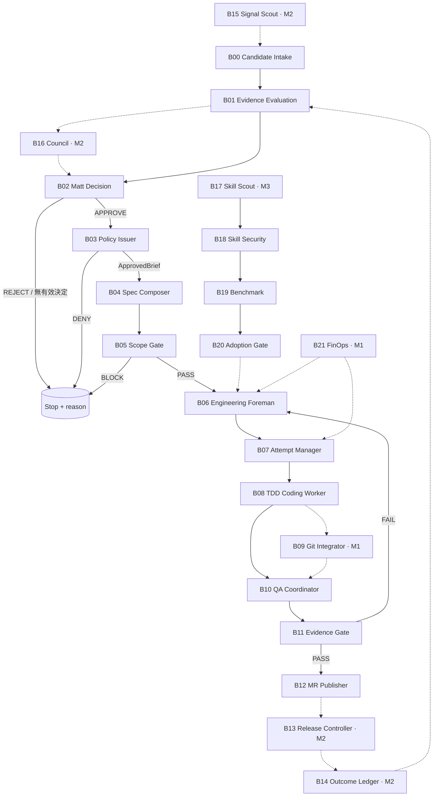

# Agent LEGO — 可獨立建構的工作流積木與持久化 Runtime

**全域強制規範 P00（新增）：** [`policies/P00-GROUNDED-ANSWER.md`](policies/P00-GROUNDED-ANSWER.md)。所有 LLM 角色遵守「直接回答、不討好、不編造、證據與推論分離」；`AGENTS.md` / `CLAUDE.md` 為 Boot 指標，`config/global-policy.json` 為版本與適用範圍，`contracts/claim-evidence.schema.json` 為重要判斷的契約。P00 為跨模組政策，不新增業務 Agent 或積木；**尚未完成正式 Runtime 強制載入與外部證據驗證。**

> v0.2 · 2026-10-21 · **設計＋契約範例＋41 項本地測試（26 契約／政策 + 15 Runtime）**；未部署、未連接 GitLab、未提供生產級授權或行程隔離。

**新增 Durable Agent Runtime 擴充**：[`DURABLE_AGENT_RUNTIME.md`](DURABLE_AGENT_RUNTIME.md) 明訂 Session-independent Jobs、Agent Identity、跨 Repo DAG、Checkpoint、失聯恢復。新增 B22–B26 五塊積木、三份 JSON Schema、SQLite 參考控制程式與測試。

原有 57 個職務的清單不是執行順序。新架構改為：**每一塊積木只負責一項可測試行為；Role 可以被多塊使用，但每塊只允許一個 Lifecycle Owner。**

## 1. 組裝規則

1. **Single Owner**：一個 Job、Spec、Review、Attempt 只有一個生命週期管理者；Agent 名稱／Skill 不賦予執行權。
2. **Contract First**：每塊先定義 `input schema → output artifact/event → reject conditions`，使用 Stub 獨立測試後才串接。
3. **Fail Closed**：未取得 Matt `APPROVE` + 可信 Issuer 的 `ApprovedBrief`，就不建立可寫入 Job。決策紀錄區分商業拒絕、逾時、證據不足和系統錯誤。
4. **No Hidden Flow**：避免兩個 Skill 同時宣稱管理整個開發生命週期；`implement-spec` 只能由工頭啟動完整執行流程，Git Integrator 不得呼叫。
5. **P00 Grounded Answer**：所有 Agent 都需遵守 `policy://P00@1.0.0`；對事實／推論／假設／未知做區分，重要結論附可核對來源；反迎合不是逢事反對。參見 [`P00`](policies/P00-GROUNDED-ANSWER.md)。
6. **Evidence ≠ Narrative**：技術成功必須有檢查紀錄與固定 SHA。Agent-to-Agent 僅傳 JSON refs，不傳冗長過程。
7. **Idempotent / Fenced**：每個重試新 `attempt_id` 與 `fence_generation`；只有資料庫中當前執行嘗試可提交結果。舊結果即使晚到且 PASS，也作廢。
8. **Cancellation Before Cleanup**：超時後撤銷租約與寫入資格、終止整個程序樹、等待退出、封存臨時成果，最後才清理 Worktree。
9. **Hard vs Semantic Scope**：程式只能保證 ID、Repo、路徑、預算等硬限制；功能語意需獨立審查。**路徑符合不代表沒有偷偷加需求。**

積木是**邏輯模組**，可在同一個程式、同一份資料庫內逐步實作；不需要微服務、訊息 Broker 或 57 個常駐 Agent。

### v0.2｜持久化模組（M0 前置＋M1 擴充）

| 模組 | 目的 | 階段 |
|---|---|---|
| [B22](modules/B22-durable-state-store.md) | Durable DB / Event Ledger / Agent Registry | M0 |
| [B23](modules/B23-identity-session-bootstrap.md) | Identity / Session Rehydration | M0 |
| [B24](modules/B24-multi-repo-coordinator.md) | Cross Repo DAG / Release Cohort | M1 |
| [B25](modules/B25-workspace-provisioner.md) | Per-attempt Worktree / Artifact Archive | M0→M1 |
| [B26](modules/B26-recovery-supervisor.md) | Reconcile / Expiry / Quarantine → B07 | M0 |

注意：B07 仍獨占 Lease / Fence / Attempt；B06 仍獨占 Job Dispatch。B22 的資料才是唯一執行狀態，不是 Agent 聊天紀錄。

獨立測試：

```bash
cd agent-lego/durable-runtime
python -m unittest discover -s . -p 'test_*.py' -v
```

SQLite 參考實作非正式持久化平台；正式環境使用 PostgreSQL、GitLab、受管理 Worker、可信 Credential／Exit Attestation。SQL 草案位於 `durable-runtime/001_postgres_schema.sql`。

## 2. 完整組裝圖



實線是 M0 必經路徑或能力線內流程；虛線代表後續啟用的插槽。M0 終點是 **MR**，不是正式部署。`B11 FAIL → B06` 必須經過重新派工、產生新 Attempt 與新證據，不可直接重用舊 Review。

## 3. 各積木單獨建構的順序

| Block | 唯一任務 | 核心 Role / Skills | 輸入 → 輸出 | 開始階段 |
|---|---|---|---|---|
| [B00](modules/B00-candidate-intake.md) | 收取需求、保留來源 | DISC.intake | 原始需求 → Candidate | M0 |
| [B01](modules/B01-evidence-evaluation.md) | 建立有證據的評估 | EVAL.product / AGENCY + product-discovery | Candidate → EvaluationPacket | M0 |
| [B02](modules/B02-decision.md) | Matt 商業拍板 | 自訂 DECISION.matt | EvaluationPacket → DecisionRecord | M0 |
| [B03](modules/B03-approval-issuer.md) | 非 LLM 授權 | AUTH.issuer | DecisionRecord → ApprovedBrief | M0 |
| [B04](modules/B04-spec-composer.md) | 規格化核准內容 | PRODUCT.owner / Matt to-spec | Brief → Spec | M0 |
| [B05](modules/B05-scope-gate.md) | 硬／語意 Scope 防擴張 | SCOPE.validator + 獨立審查 | Spec/Job/Brief → PASS/BLOCK | M0 |
| [B06](modules/B06-foreman.md) | 工頭唯一派工生命週期 | ENG.foreman / ASK agent-workflows + Matt to-tickets | Ready Ticket → Job | M0 |
| [B07](modules/B07-attempt-manager.md) | 重試、逾時、取消、工作區隔離 | ORCH.attempt / 程式狀態機 | Job → Attempt + Fence | M0 |
| [B08](modules/B08-coding-worker.md) | TDD 與實際工作 | ENG.worker / Matt tdd + Ponytail + RTK | Task → Commit + Tests | M0 |
| [B09](modules/B09-git-integrator.md) | 並行結果整合 | ENG.git / bounded Git | 多 Commit → Integration SHA | M1 |
| [B10](modules/B10-qa-coordinator.md) | 只啟動一次雙軸審查 | QA.coordinator / Matt code-review | SHA + Spec → QA Evidence | M0 |
| [B11](modules/B11-evidence-gate.md) | 檢查證據和 SHA | QA.evidence + 非 LLM Gate | Review/CI → Evidence Manifest | M0 |
| [B12](modules/B12-mr-publisher.md) | 建立 GitLab MR | ENG.git / Matt pr | Gate PASS → MR | M0 |
| [B13](modules/B13-release-controller.md) | 正式 Release 授權 | REL.controller + DevOps / ship-gate | MR + Release Policy → Release | M2 |
| [B14](modules/B14-outcome-ledger.md) | 結果追蹤、保留原預測 | OUTCOME.evaluator | 使用數據／原決策 → Outcome | M2 |
| [B15](modules/B15-signal-scout.md) | 自動海巡市場訊號 | DISC.signal / market-research | 公開來源 → Candidate | M2 |
| [B16](modules/B16-council-deliberation.md) | 交叉審議 | COUNCIL.review | Evaluation → CouncilVerdict | M2 |
| [B17](modules/B17-skill-scout.md) | 發現 Skill/Model 候選 | CAP.scout / research + loop-library | 能力缺口 → Skill Candidate | M3 |
| [B18](modules/B18-skill-security.md) | 釘選版本安全檢查 | CAP.security / skill-security-auditor | Candidate → Security Finding | M3 |
| [B19](modules/B19-capability-benchmark.md) | 隔離基準測試 | CAP.benchmark / skill-doctor + skillopt-sleep | Candidate → Benchmark | M3 |
| [B20](modules/B20-skill-adoption.md) | 准入並版本化 | CAP.adoption / 非 LLM Gate | Evidence → Versioned Registry | M3 |
| [B21](modules/B21-finops-telemetry.md) | 真實成本統計與告警 | FINOPS.cost / RTK + Provider Billing | Tool/Provider Usage → Cost | M1 |

**目前共 27 塊（原 B00–B21 加 B22–B26），不用一次建完。** M0 啟用 B00–B08、B10–B12；M1 才加入 B09 與 B21；M2 插入 B13–B16；M3 再建 B17–B20。任一模組都能用 `examples/` 的假資料獨立測試，不必先啟動上游 Agent。

## 4. 每塊的標準交接格式

**四份契約文件：**

- [`contracts/approved-brief.schema.json`](contracts/approved-brief.schema.json)：決策、Issuer、Repo、Scope IDs、驗收 IDs、路徑、額度、有效期、可執行操作。
- [`contracts/job-attempt.schema.json`](contracts/job-attempt.schema.json)：Job 當前 Attempt 指標、遞增 Fence；每次重試形成新的 Attempt 記錄。
- [`contracts/evidence-manifest.schema.json`](contracts/evidence-manifest.schema.json)：Commit SHA、Test、CI、Standards Review、Spec Review、語意 Scope Review 等可稽核證據。
- [`a2a-compact/message.schema.json`](a2a-compact/message.schema.json)：**既有 A2A v1 的升級版 v2**，TASK／RESULT 強制攜帶 `attempt_id`、`fence_generation`。不要將 v1 Job 混入可重試系統。

範例在 [`examples/`](examples/)，皆為示意資料；不構成真實批准、測試通過或 GitLab Commit。

### 狀態與重試（唯一真相來源是資料庫）

```text
Job RUNNING(current_attempt=A2, fence=2)
    │
    ├─ RESULT(A1, fence=1) → DROP_STALE
    └─ RESULT(A2, fence=2)
          ├─ proof invalid → BLOCK
          └─ proof valid   → CAS UPDATE → DONE

on_timeout(A2):
    1. DB CAS → revoke A2/fence lease（禁止結果提升為有效交付）
    2. revoke credentials and write authorization
    3. terminate worker process group / container + descendants
    4. wait for verified process exit; if unconfirmed → QUARANTINE, NO CLEANUP
    5. seal or archive staged artifacts
    6. remove isolated worktree only after step 4
    7. optionally start A3 with a new fence
```

**注意**：這套流程需以非 LLM 的狀態機、交易更新、程序監控與獨立權限機制實作。現在的 `control/reference.py` 只是可測的契約參考，不能當正式安全控制器。

### Scope 的兩層判定

| 檢查 | 誰負責 | 可以保證 | 無法保證 |
|---|---|---|---|
| Hard Scope Gate | 程式 | 需求 ID、Repo、路徑、允許操作、額度與授權效期 | 改同一支程式時是否偷偷改變產品行為 |
| Semantic Scope Review | 與實作者獨立的 QA/產品審查 | 提供可追溯的規格符合度判斷與人工可檢證理由 | 無法以模型判斷提供數學上完備保證 |

任一檢查缺失 → `BLOCK`；語意審查與被驗的 SHA 綁定。

## 5. Skill 生命週期唯一 Owner

| 運作模式 | 完整流程 Skill | 唯一發動者 | 其他角色 |
|---|---|---|---|
| M0 單一 Worker | Matt `tdd` | ENG.worker | ENG.foreman 只啟動 TASK |
| M0 單一 Review | Matt `code-review` | QA.coordinator | QA.standard / QA.spec 只提供各自審查結果 |
| M1 DAG + Worktree | Matt `implement-spec` | ENG.foreman | ENG.git 只接受已切出的有界整合任務，不再呼叫整份 Skill |
| M1 Review | 由 `implement-spec` 內部調度 `code-review` | ENG.foreman 為執行 Owner | QA.coordinator 僅獨立核對既有 Review Evidence，不得再重跑整套 Review |
| 全階段 | ASK `agent-workflows` | ENG.foreman 作調度策略參考 | **不啟用 ASK `develop` 當第二套開發主控** |

`config/ownership.json` 是初始角色／Skill 所有權配置；實際程式須依運作模式鎖定誰可執行什麼，而不是依 Agent 回傳文字決定。

## 6. 建構順序與 Gate 驗收

### M0 — 先獨立測試，不先串 57 個角色

| 組裝階段 | 積木組合 | 要證明的事 |
|---|---|---|
| M0-A：契約 | B03 + B05 + B07 + B11 | Schema、拒絕、重試、SHA 綁定，全部可用假資料測試 |
| M0-B：單一 Worker | B06 + B07 + B08 | 已核准且有界的 Ticket 能產生測試／Commit |
| M0-C：單一 QA | B10 + B11 | Reviewer 只啟動一次、結果獨立且不能驗收舊 SHA |
| M0-D：完整串接 | B00→B01→B02→B03→B04→B05→B06→B07→B08→B10→B11→B12 | 一次合法 MR、一次未批准拒絕、一次錯誤範圍阻擋、一次中斷可恢復 |

M0-D 並不是說必須在第一天就接市場 API；需求來源可以是人工輸入，決策可以先用固定測試資料，GitLab 使用測試專案。真正成敗由端到端測試決定。

### 已實作在範例測試中的失敗情境

- 舊 Attempt 延遲傳回 `DONE` → **無效**。
- 工作超時／取消後程序尚未退出 → **禁止 Worktree 清理**。
- `ENG.git` 偷用完整 `implement-spec`、`QA.spec` 在 M0 重複呼叫 `code-review` → **拒絕**。
- Spec 在核准 Repo／路徑內改動但新增未批准功能 → **Hard Gate 不能宣稱涵蓋；缺獨立語意證據即拒絕**。
- QA SHA 與預定合併的 SHA 不一致 → **拒絕**。
- ApprovedBrief 遭修改、逾期、缺可信簽發紀錄 → **拒絕**。
- 沒有實際 Evidence Ref，只有 `PASS` 字串 → **拒絕**。

在 `agent-lego` 目錄執行：

```bash
python -m pip install 'jsonschema>=4'
python -m unittest discover -s tests -v
```

此測試檢查 **Schema + 參考判定邏輯**，不是 GitLab、模型、Sandbox 的端到端測試。`jsonschema` 可讀 Draft 2020-12；部署環境仍需真實 DB CAS、JWT/簽章或可信授權憑證、CI API 驗證與程序隔離。

## 7. 各元件的原始來源

- [Agency Agents](https://github.com/msitarzewski/agency-agents)：職務 Profiles，按模組調用。
- [Council of High Intelligence](https://github.com/0xNyk/council-of-high-intelligence)：審議規則，B16。
- [Matt Pocock Skills](https://github.com/mattpocock/skills)：B04/B06/B08/B10 的工程 SOP；`implement-spec` 不可同時由多個角色掌控。
- [ASK Agent Workflows](https://github.com/MarkBovee/agent-skills-kit/blob/main/skills/ask-agent-workflows/SKILL.md)：B06 調度與預算策略，不啟用其第二套 `develop` 流程。
- [Ponytail](https://github.com/DietrichGebert/ponytail)：B08 最小完整實作。
- [RTK](https://github.com/rtk-ai/rtk)：B08 工具輸出過濾，B21 統計，不等於全帳單省幅。
- [Claude Skills Library](https://github.com/alirezarezvani/claude-skills)：B01/B13–B20 領域 Skill 候選；先釘選原始版本、安全測試後再用。

## 8. 與前版文件的關係

- [`reference/AGENT_ROLE_SKILL_FLOW.md`](reference/AGENT_ROLE_SKILL_FLOW.md)：保留原版 57 個職務與 Skills 對照，作為 **可用角色目錄**，不要求全部啟動。
- [`reference/AGENT_ORGANIZATION.md`](reference/AGENT_ORGANIZATION.md)：原先部門權限規範。
- [`reference/ARCHITECTURE.md`](reference/ARCHITECTURE.md)：高階系統架構。
- `a2a-compact/` 內是**新版 v2**，不是原始 v1；不得同時讓不同 Worker 猜測版本。

**建議第一個正式實作單位：B03 Approval Issuer + B07 Attempt Manager。** 這兩塊先有正確的授權與執行隔離，後面才能安全添加更多 Agent 與 Skills。

## P00 參考測試（v0.3）

```bash
cd agent-lego
python -m pip install 'jsonschema>=4'
python -m unittest discover -s tests -v
cd durable-runtime && python -m unittest discover -s . -p 'test_*.py' -v
```

P00 測試涵蓋政策缺漏／SHA 竄改、事實／推論必須有 Evidence refs、未知不能宣稱 SUPPORTED、未經驗證的來源、不相符的 Job/Attempt、矛盾未解決不得宣稱已證實。來源 Ref 解析與語意正確性仍需正式外部 Artifact Registry 和獨立實證查核；參考碼不能證明真實部署已完成。
