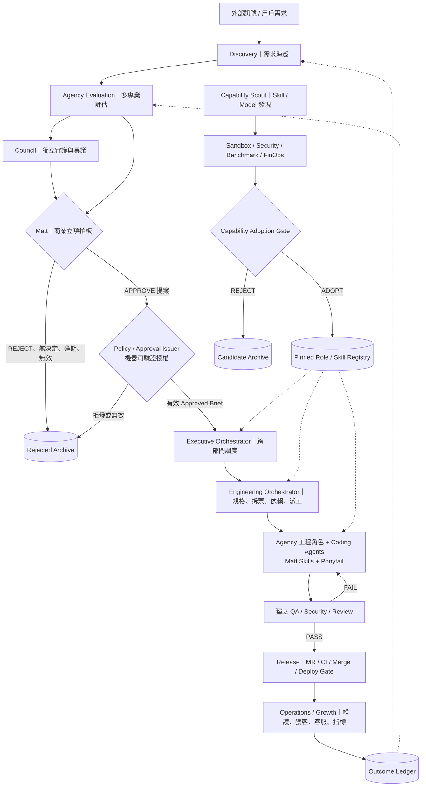

# Agent Organization — 職務、權限與交接契約

> 狀態：設計草案（尚未完成部署或整合驗證）  
> 版本：0.2 · 2026-10-21  
> 上位文件：[ARCHITECTURE.md](./ARCHITECTURE.md)  
> 通訊規範：[a2a-compact/SKILL.md](./a2a-compact/SKILL.md)

## 1. 組織原則

1. **Role ≠ Agent Instance ≠ Model ≠ Skill ≠ Permission**。Role 定義工作責任；執行個體承接工作；模型提供推理；Skill 提供方法；權限由控制層授予。
2. **Agency 是跨部門的專業角色池**，不是只負責需求潛力判斷。同一角色可在多個階段被借調，但每次任務都重新限定權限與輸出。
3. **Council 是審議方法**，不是批准人；Council 可使用不同視角挑戰 Agency 的評估，但無立項或派工權。
4. **Matt Decision Gate 是本專案自訂的商業立項決策點**，不是 `mattpocock/skills` 內建的商業決策功能。Matt 明確拍板後，還要由可信的 Policy/Approval Issuer 確認授權，才可能派工。
5. **沒有有效批准就 REJECT，立即終止本次候選案**。對執行層一律不放行；資料層保留拒絕原因（商業否決／證據不足／逾時／系統錯誤）以免污染後續分析。
6. **審查者不可自行改寫原任務、預算或驗收標準**；各部門只能在授權範圍內產出自己的專業成果。
7. **訊息只傳遞結構化資訊與產物引用**。Agent-to-Agent 使用 `a2a-compact`；完整證據、報告、程式碼留在有版本的 artifacts 中。
8. **自我改善不等於自我授權**。新 Skill／模型可被研究、測試、提出導入建議，但不能未經准入就變更正式執行環境。

## 2. 架構與指揮鏈



> 說明：所有節點是**邏輯職務**，不要求每一格都是一個常駐 Agent、模型或獨立服務。第一版可用單一控制程式、資料庫、工作佇列與隔離執行個體承載。

## 3. 部門與主要職責

| 部門 / 單位 | 主要責任 | 進入條件 | 交付物 | 無權執行 |
|---|---|---|---|---|
| D01 Discovery | 尋找、蒐集、去重、整理真實需求線索 | 排程或指定研究任務 | `DemandCandidate` + evidence refs | 核准、建可執行工程 Ticket |
| D02 Evaluation | 市場、使用者、技術、財務、風險評估 | 有可追溯候選需求 | `EvaluationPacket` | 核准、派工、部署 |
| D03 Council | 獨立分析、交叉質疑、保留異議與 kill criteria | 收到 EvaluationPacket | `CouncilVerdict`（建議，不是授權） | 直接批准開發 |
| D04 Decision | Matt 最終商業決策與理由；發起授權請求 | 評估、審議、證據完整性可檢查 | `DecisionRecord` | 自行修改工程碼、跳過 Policy Gate |
| D05 Policy / Approval Issuer | 檢查決策身分、核准範圍、預算、效期與風險政策 | `DecisionRecord == APPROVE` | 簽發／拒發 `ApprovedBrief` | 修改商業判斷或偷偷放寬政策 |
| D06 Executive Orchestration | 跨部門路由、持久化狀態、預算配額、錯誤恢復 | 有效事件與相應權限 | `DispatchRecord` / 工作事件 | 自行批准產品 |
| D07 Product / Design | 將核准目標轉成需求規格、體驗與設計成果 | 已簽發 `ApprovedBrief` | `Spec` / 設計 artifacts | 擴充核准範圍 |
| D08 Engineering | 拆票、依賴圖、實作、TDD、整合 | 有效批准 + Ready Ticket | Commit / Tests / MR | 自行 Merge、部署、付款 |
| D09 QA / Security | 驗證功能、規格與安全；擋下不合格交付 | 可查的 Spec、Diff 與測試 | `VerificationResult` | 改寫批准標準、自己批准自己 |
| D10 Release / SRE | CI/CD、授權發布、事故處理、觀測性 | QA 通過 + 正式發布授權 | Release / Runbook / Incident Record | 自行增加功能或跳過審核 |
| D11 Growth / Operations | 產品營運、獲客、客服、留存與商業成果量測 | 已核准的上線／營運範圍 | Metrics / Experiments / Outcome | 偷改原立項證據、擅自外部付款 |
| D12 Capability R&D | 新 Skill／模型／MCP 搜尋、測試、優化 | 排程或執行資料揭露瓶頸 | Benchmark / Adoption Proposal | 直接安裝進正式環境 |
| D13 FinOps / Governance | 預算、用量、告警、政策審計 | 系統遙測與審計事件 | Cost / Policy Findings | 自己調高額度、審批自己 |

### 3.1 共用角色池的運作方式

- 一個 `agency-agents` 角色可被不同部門引用；派工時附上 `department`、`role_id`、`job_id`、`allowed_tools`、`scope_ref`、`acceptance_ref` 與 `budget`。
- 專業名稱代表**能力候選**而非正式授權。例如 `Software Architect` 在 Evaluation 階段只能出技術可行性報告，在 Engineering 階段才可能獲得只限隔離工作區的寫入權。
- 不能因角色自稱 Senior / CTO / Security 就取得更高權限。所有工具權限由執行環境發給短效憑證，不從 Prompt 文字判斷。
- 不需要一次啟動兩百多個角色：根據 `Agent Registry` 中的能力標籤、任務型態、成本、可用性和權限挑選最少必要數量。

## 4. Agency 角色配置（初始映射）

以下列出的為 `msitarzewski/agency-agents` 目前有對應名稱的角色**候選**，實際任務需要依其原始角色檔與專案需求再次驗證；本表不是完整角色清單。

| 部門 | Agency 候選角色 | 責任與主要輸出 |
|---|---|---|
| Discovery | `Trend Researcher`、`Feedback Synthesizer`、`UX Researcher` | 有來源的市場訊號、使用者問題、現有替代方案 |
| Evaluation | `Product Manager`、`Business Strategist`、`Finance Tracker` | 問題定義、經濟性、競爭及需求證據分析 |
| Evaluation（視需求） | `Software Architect`、`Security Architect`、`Discovery Coach` | 技術風險、安全風險、訪談問題設計 |
| Executive Orchestration | `Agents Orchestrator`、`Studio Producer`、`Project Shepherd` | 跨部門派工建議、工作狀態、依賴管理 |
| Product / Design | `Product Manager`、`UX Architect`、`UI Designer`、`UX Researcher` | Spec、使用流程、設計 artifacts、驗收依據 |
| Engineering | `Frontend Developer`、`Backend Architect`、`Senior Developer`、`AI Engineer`、`Rapid Prototyper` | 已授權範圍內的程式碼及測試 |
| Engineering / Release | `DevOps Automator`、`Git Workflow Master`、`SRE` | CI/CD、整合、回復策略與維運 |
| QA / Security | `Code Reviewer`、`Reality Checker`、`API Tester`、`Evidence Collector`、`Security Architect` | 由證據支撐的獨立驗收結果 |
| Growth | `Growth Hacker`、`SEO Specialist`、`Social Media Strategist`、`Sales Outreach` | 授權的成長實驗、獲客工作與紀錄 |
| Operations | `Support Responder`、`Analytics Reporter`、`Experiment Tracker`、`Infrastructure Maintainer` | 用戶回饋、績效、事故與營運報告 |
| Capability R&D | `Tool Evaluator`、`Workflow Optimizer`、`AI Engineer`、`Model QA Specialist` | 工具比較、工作流優化、模型評測 |
| FinOps / Governance | `FinOps Engineer`、`Finance Tracker`、`Security Architect` | 用量診斷、風險報告與決策依據 |

### 4.1 Council 是方法，Agency 是專業角色

- Council 實作來自 [`0xNyk/council-of-high-intelligence`](https://github.com/0xNyk/council-of-high-intelligence)。可用 full / quick / duo / triad 在重要決策點進行分析。
- Council 輸出異議、未證實假設、關鍵風險、`kill_criteria`、`next_action`；不得直接發出 `APPROVE` 執行權杖。
- 評估包標註 `FACT`、`INFERENCE`、`ASSUMPTION`、`UNKNOWN`；多個 Agent 贊成不等於市場驗證。
- 除非有不同外部資料來源，模型視角之間的高度相關性必須記錄，不能把投票數當獨立證據數。

## 5. Matt Gate：最終決策與硬性授權分離

此處 **Matt 為本專案的決策角色名稱**，不是 `mattpocock/skills` 作者或其 Repo 已提供的決策服務。其權力是「商業拍板」；技術執行權由獨立控制程式簽發。

```text
Agency 評估 + Council 審議 + Evidence
                    ↓
             Matt Decision
           ├─ REJECT ───────> 結案
           └─ APPROVE ──────> Policy/Approval Issuer
                                   ├─ 無法驗證 ─> REJECT（不放行）
                                   └─ 簽發 ApprovedBrief ─> Dispatcher
```

**簽發條件**（全部滿足才放行）：

- `DecisionRecord.decision == APPROVE` 且身分、事件 ID、政策版本與決策有效期通過驗證。
- `approved_scope`、`acceptance_criteria`、`budget`、`risk_tier`、可操作 Repo／環境皆明確。
- Evidence refs 可追溯；高風險操作所需的人類／額外授權已取得。
- Approved Brief 與 Ticket／Spec 連結不可任意篡改；下游執行前驗證範圍與版本。

**不批准的統一處置**：外部狀態 `REJECTED`、不可派工；內部保留 `BUSINESS_REJECT`、`EVIDENCE_INSUFFICIENT`、`TIMEOUT`、`INVALID_DECISION`、`POLICY_DENIED` 等原因。這不是「先 Pending 等到有空再做」。新證據出現時新建候選案，不覆寫舊決策。

## 6. 工頭與工程流水線

`mattpocock/skills` 提供工程 SOP，不是商業決策引擎或永久執行服務。工頭可按 Ticket 選用：

```text
ApprovedBrief (verified)
  → Spec / acceptance lock
  → to-spec
  → to-tickets (vertical slices + dependency DAG)
  → implement-spec (ready frontier; isolated branch/worktree)
      → implement
      → tdd (red → green → refactor)
      → code-review (spec + engineering quality)
      → integrate
  → MR / CI / QA Gate / Release Gate
  → retro / metrics
```

- 在生成每張 Ticket 之後、派工之前，**以程式檢查其 parent scope / acceptance refs**。超出核准範圍就擋下並回到需求變更流程。
- 工頭可使用 `ask-matt` 作為**明確呼叫的 Skill Router**；其原始 Skill 設定為 user-invoked，不能假設模型會自行呼叫。`implement-spec` 的 Sub-agent 平行策略是已定義的流程，但可靠性仍需整合測試。
- **Ponytail**（[`DietrichGebert/ponytail`](https://github.com/DietrichGebert/ponytail)）作用於工程實作與審查：優先重用、最小完整 Diff、保留安全、驗證與必要測試；它不是 Agent-to-Agent 訊息 Schema。
- `a2a-compact` 作用於所有 Agent 交接：訊息精簡、固定欄位與 Artifact refs；不會縮短驗收證據、程式碼或必要錯誤資訊。
- GitLab MR／CI 需要外部授權，無論模型自稱完成都不得跳過測試或 Release Gate。

## 7. 任務權限矩陣（初始原則）

權限由 Policy Engine 和外部工具憑證執行；以下的 `R` 表示可讀，`W` 表示範圍內可寫，`G` 表示可阻擋，`—` 為未授權。

| 職務 | 公開資料 | 評估／決策資料 | 專案程式碼 | 可執行 Ticket | MR／Release | 正式 Skill Registry |
|---|---|---|---|---|---|---|
| Discovery | R | W（候選） | — | — | — | — |
| Evaluation / Council | R | R/W（報告） | R（需要時） | — | — | — |
| Matt Decision | R | W（決策記錄） | R（必要時） | — | — | — |
| Policy/Approval Issuer | — | R/W（簽發授權） | — | — | — | — |
| Executive Orchestrator | R | R | R | W（有效批准後） | — | R |
| Engineering Orchestrator | — | R | R | W（已批准） | — | R |
| Implementer | — | R（限定 Scope） | W（隔離工作區） | W（限定 Job） | W（建立 MR，不能 Merge） | R |
| QA / Security | R（必要時） | R | R | W（驗證結果） | G（可擋發布） | R |
| Release Controller | — | R（授權） | R | R | W（依 Release Policy） | R |
| Growth / Operations | R/W（已授權任務） | R（相關部分） | R（必要時） | — | — | — |
| Capability Scout | R | — | R（有限） | — | — | W（候選區） |
| Adoption Gate | — | — | — | — | — | W（審核通過後） |
| FinOps | — | R（成本相關） | — | G（預算限流） | — | R |

> 表格中的 W 並非全域讀寫。例如 Implementer 只有對指定 Worktree 的權限；Release Controller 只有在可驗證的 Release Authorization 存在時才可觸發部署。

## 8. Agent Registry：最小欄位

每個角色配置至少保存以下欄位，並以版本化資料管理（YAML／JSON 或 DB）。

```yaml
role_id: engineering.frontend
source:
  repo: msitarzewski/agency-agents
  path: engineering/engineering-frontend-developer.md
  revision: '<pinned commit SHA>'
department: engineering
capabilities: [frontend, react, ui-implementation]
invocation: on-demand
allowed_stage: [IMPLEMENTING]
allowed_tools: [repo.read, sandbox.write, tests.run, mr.create]
disallowed_tools: [decision.approve, production.deploy, skill_registry.publish]
skills: [tdd, code-review, ponytail, a2a-compact]
input_contract: task.v1
output_contract: result.v1
budget_policy_ref: policy://engineering-default
escalation_to: engineering.orchestrator
```

Role Registry 不等於 Skill Registry：前者記「誰能做什麼」，後者記「有哪些已測試、可裝載的方法」。兩者透過 `role.skills` 連結，版本鎖定後才執行。

## 9. Agent-to-Agent 交接：只傳必要訊息

參照 [`a2a-compact/SKILL.md`](./a2a-compact/SKILL.md) 與 [`message.schema.json`](./a2a-compact/message.schema.json)。此介面為**本專案自訂**，不是 agency-agents、Ponytail、Council 或 Matt Skills 的原生協定。

### 發派任務

```json
{"v":"1","type":"TASK","job_id":"JOB-17","role":"engineering.frontend","scope_ref":"brief://DEC-9","input_refs":["spec://SPEC-9","ticket://GL-41"],"acceptance_ref":"criteria://DEC-9","policy_ref":"policy://dev-default"}
```

### 回報完成

```json
{"v":"1","type":"RESULT","job_id":"JOB-17","state":"DONE","artifact_refs":["commit://abc123","mr://GL-51"],"check_refs":["ci://PIPE-82"]}
```

### 回報阻塞

```json
{"v":"1","type":"RESULT","job_id":"JOB-17","state":"BLOCKED","reason_code":"MISSING_SECRET","next_action":"REQUEST_AUTHORIZED_SECRET","detail_ref":"artifact://blocker/JOB-17"}
```

**規則：**訊息內容不得含開場白、回顧、主觀評論或推測完成；任務細節放 artifact，僅傳 refs；錯誤資訊完整保存於 `detail_ref`。訊息欄位由 Schema 驗證，不合格拒收或要求一次格式修正。對人的正式報告可另外生成，不受 A2A 壓縮規範限制。

## 10. 自我改善線：能力供應，不是商業拍板

```text
Skill/Model Scout
  → 候選搜尋（原始 Repo、skills.sh、SkillsMP、claude-skills）
  → 來源／授權／腳本／Prompt Injection 檢查
  → 沙盒測試 + 固定 Benchmark
  → FinOps 比較（正確率／重試／延遲／成功交付成本）
  → Adoption Gate（准入／拒收）
  → Pinned Skill Registry + Canary + Rollback
```

- Scout 無正式 Registry 寫入或正式環境部署權；Adoption Gate 亦不可變更產品 `ApprovedBrief`。
- `retro`、`writing-for-agents`、`handoff` 可改善文件與工程環境；`Ponytail` 避免過度工程；`a2a-compact` 減少交接訊息膨脹。四者目的不同。
- 市場決策的模型訓練需可信的 `Decision Ledger`、`Outcome Ledger`、資料歸因與獨立評測，列為長期研究；不阻擋第一版。

## 11. 最低可驗收實作（組織與授權）

1. 任務有可追蹤的 `job_id`、`role_id`、`scope_ref`、`policy_ref`，只有指定角色能取得指定工具權限。
2. `REJECT`、沒拍板、逾時、偽造 `APPROVE`、Scope 不符、超預算：**全部不得派發開發任務**；拒絕原因獨立記錄。
3. 合法批准：可簽發有限期 Approved Brief；Spec、Ticket、Worktree、MR 均可回溯到該批准。
4. Implementer 完成後回傳 Schema 合法的最小 `RESULT`；不需要重述需求或對工頭寫說明文章。
5. QA／CI 不通過時，即使 Implementer 回報 `DONE`，也不得 Merge／Deploy。
6. 任務中斷、重複事件、模型逾時：恢復時不重複派發具有外部副作用的任務。
7. Skill Registry 的新版本不得繞過安全評測、准入規則與回滾機制。

## 12. 組態待定，不當成已實作事實

- 決策者 Matt 的具體模型、判定規則、授權身分及人工覆核政策。
- Executive／Engineering Orchestrator 的 Runtime、DB、佇列、分散式鎖。
- 各種 Agency 角色的精確來源修訂版、可用 Skill、API／CLI 相容性與實測性能。
- 資料來源的擷取政策、成本與頻率，GitLab 專案權限／MR／CI／部署策略。
- 對外發布、收款、付款、會員資料存取及個資安全控制。

## 13. 上游參考

- [msitarzewski/agency-agents](https://github.com/msitarzewski/agency-agents) — 角色定義與 Runbooks
- [0xNyk/council-of-high-intelligence](https://github.com/0xNyk/council-of-high-intelligence) — 結構化審議
- [mattpocock/skills](https://github.com/mattpocock/skills) — 工程 SOP／派工／TDD／Review／Retro；其中 `writing-for-agents` 與 `handoff` 有助縮短交接文件
- [DietrichGebert/ponytail](https://github.com/DietrichGebert/ponytail) — 最小完整程式碼與精簡回覆
- [alirezarezvani/claude-skills](https://github.com/alirezarezvani/claude-skills) — Skill 候選、評估與自我改善工具

---

**核心規則：角色可共享、權限不共享；評估不能批准，沒有批准就拒絕；工頭只派已獲授權的工作；Agent 間傳結構化結果，不傳廢話。**


---

> **v0.3 政策補充：** 請以 [`P00-GROUNDED-ANSWER.md`](../policies/P00-GROUNDED-ANSWER.md) 為所有角色必須遵守的全域實證回答規範；其唯一真相來源為 `policies/`，本參考文件不重複政策條文。
