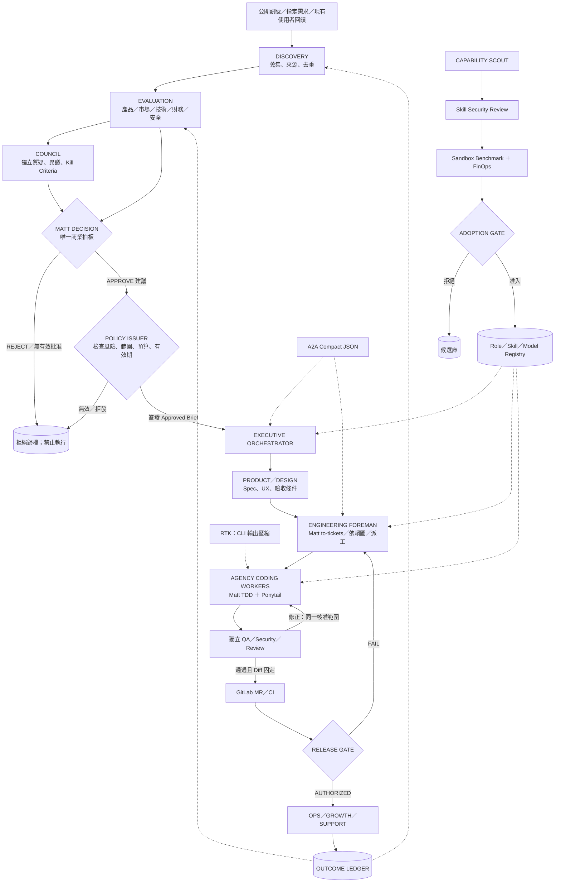
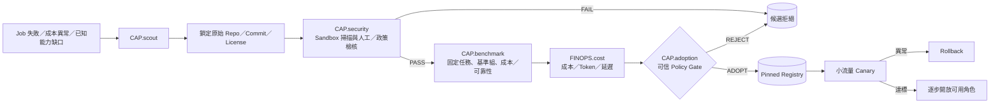

# Autonomous Product Organization — 角色、Skills、權限與端到端工作流

> **文件類型**：技術架構／職務規格／執行契約（可直接作為 Agent Registry 與工作流實作依據）  
> **版本**：v1.0-draft｜2026-10-21  
> **狀態**：已完成工具來源與角色名稱的文件核對；**尚未安裝、整合或執行端到端測試**。  
> **相關文件**：[`ARCHITECTURE.md`](./ARCHITECTURE.md) · [`AGENT_ORGANIZATION.md`](./AGENT_ORGANIZATION.md) · [`a2a-compact/SKILL.md`](./a2a-compact/SKILL.md) · [`a2a-compact/message.schema.json`](./a2a-compact/message.schema.json)

## 0. 決策摘要

**產品線**：需求來源 → Discovery → 專業評估 → Council 審議 → Matt Decision → Policy Authorization → Product/Engineering → TDD → Independent QA → MR/CI/Release → Growth/Operations → Outcome。  
**能力線**：Skill/Model 探勘 → 安全檢查 → 隔離 Benchmark → 成本與效果比較 → Adoption Gate → 版本化 Registry → 受控部署／回滾。  
**訊息**：Agent-to-Agent 一律使用最小 JSON 契約；詳細資訊保存在 Artifact；禁止用自然語言散文作跨 Agent 的主要協定。  
**禁止越權**：Agency 角色不能因名稱取得權限；Council 不能批准；Matt 的文字判斷不是授權憑證；沒有有效 Approved Brief 就不能派工開發；能力改善不能自行部署。

### 0.1 四種概念不能混淆

| 類型 | 定義 | 來源／例子 |
|---|---|---|
| **Role** | 職務與專業責任，描述「由誰負責什麼」 | `agency-agents` 的 `Frontend Developer`、`UX Researcher` |
| **Skill** | 受版本管理的工作方法，描述「如何做」 | Matt `tdd`、ASK `agent-workflows`、Ponytail |
| **Runtime/Tool** | 真正可執行的能力與介接 | Codex／Claude Code、GitLab、CI、RTK、Sandbox |
| **Authority** | 可讀／可寫／可執行／可批准的權限 | Policy Engine、具範圍／期限的權限憑證 |

一個 Role 能載入多個 Skill；同一 Skill 可以被多個 Role 使用；Skill 不等於有權限的 Agent；Role Profile 也不等於已運作的獨立進程。

---

## 1. 已選工具的固定定位

| 來源代碼 | 專案／工具 | 職責定位 | 不負責 | 採用策略 |
|---|---|---|---|---|
| `AGENCY` | [msitarzewski/agency-agents](https://github.com/msitarzewski/agency-agents) | 跨部門專業角色 Profile／職能庫 | 原生跨部門執行平台、批准權、完整工具權限 | **共用角色池**，按任務載入 |
| `COUNCIL` | [0xNyk/council-of-high-intelligence](https://github.com/0xNyk/council-of-high-intelligence) | 多視角審議、質疑、異議、失敗條件 | 商業批准與開發執行權 | 固定於評估／重大變更審議 |
| `MATT` | [mattpocock/skills](https://github.com/mattpocock/skills) | Spec／Tickets／Implement／TDD／Review／Retro | **內建商業 APPROVE/REJECT 決策** | 工程 SOP 主方案 |
| `ASK` | [MarkBovee/agent-skills-kit](https://github.com/MarkBovee/agent-skills-kit) | `agent-workflows` 調度、風險深度、成本與證據回報規則 | 替代 Policy Engine、全面接管 Matt | **抽取調度規則**，不啟用雙重工程 Router |
| `PONYTAIL` | [DietrichGebert/ponytail](https://github.com/DietrichGebert/ponytail) | 重用優先、最小完整 Diff、必要測試與安全 | A2A 訊息規格 | Coding workers 的實作約束 |
| `A2A` | 本專案 `a2a-compact` | JSON TASK／RESULT、Refs、可驗證機器交接 | 縮減正式審核證據、替代授權 | **所有內部 Agent 共同遵守** |
| `RTK` | [rtk-ai/rtk](https://github.com/rtk-ai/rtk) | CLI 工具輸出過濾、用量估算 | 壓縮所有輸入、所有 Token 或 A2A 訊息 | Runtime 選配；先測 CLI Filtering |
| `CLAUDELIB` | [alirezarezvani/claude-skills](https://github.com/alirezarezvani/claude-skills) | 市場、產品、成長、監控與 Skill R&D 候選 | 已驗證的無條件可用性 | 按角色載入且鎖定版本 |
| `GITLAB` | GitLab Issues／MR／CI/CD | 版本、票據、審查與交付證據 | 商業判斷、模型決策 | 系統記錄與交付落點 |

**唯一工程流程主幹**：`MATT`；`ASK` 的 `agent-workflows` 只擔任 Dispatcher 的策略參考。不要同時讓 ASK `develop` 和 Matt `implement-spec` 都宣稱擁有同一個 Job 的生命週期控制權。

### 1.1 Skill ID 與來源索引（真實核對路徑）

以下縮寫只在本文件用於減少重複；實際 Registry 要存完整 Repo、路徑、版本 SHA。

| ID | 完整來源 Skill |
|---|---|
| `M:setup` | [Matt `setup-matt-pocock-skills`](https://github.com/mattpocock/skills/blob/main/skills/engineering/setup-matt-pocock-skills/SKILL.md) |
| `M:grill` | [Matt `grill-with-docs`](https://github.com/mattpocock/skills/blob/main/skills/engineering/grill-with-docs/SKILL.md) |
| `M:domain` | [Matt `domain-modeling`](https://github.com/mattpocock/skills/blob/main/skills/engineering/domain-modeling/SKILL.md) |
| `M:spec` | [Matt `to-spec`](https://github.com/mattpocock/skills/blob/main/skills/engineering/to-spec/SKILL.md) |
| `M:tickets` | [Matt `to-tickets`](https://github.com/mattpocock/skills/blob/main/skills/engineering/to-tickets/SKILL.md) |
| `M:implement-spec` | [Matt `implement-spec`](https://github.com/mattpocock/skills/blob/main/skills/engineering/implement-spec/SKILL.md) |
| `M:implement` | [Matt `implement`](https://github.com/mattpocock/skills/blob/main/skills/engineering/implement/SKILL.md) |
| `M:tdd` | [Matt `tdd`](https://github.com/mattpocock/skills/blob/main/skills/engineering/tdd/SKILL.md) |
| `M:debug` | [Matt `diagnosing-bugs`](https://github.com/mattpocock/skills/blob/main/skills/engineering/diagnosing-bugs/SKILL.md) |
| `M:review` | [Matt `code-review`](https://github.com/mattpocock/skills/blob/main/skills/engineering/code-review/SKILL.md) |
| `M:pr` | [Matt `pr`](https://github.com/mattpocock/skills/blob/main/skills/engineering/pr/SKILL.md) |
| `M:triage` | [Matt `triage`](https://github.com/mattpocock/skills/blob/main/skills/engineering/triage/SKILL.md) |
| `M:retro` | [Matt `retro`](https://github.com/mattpocock/skills/blob/main/skills/engineering/retro/SKILL.md) |
| `M:research` | [Matt `research`](https://github.com/mattpocock/skills/blob/main/skills/engineering/research/SKILL.md) |
| `M:handoff` | [Matt `handoff`](https://github.com/mattpocock/skills/blob/main/skills/productivity/handoff/SKILL.md) |
| `M:writing` | [Matt `writing-for-agents`](https://github.com/mattpocock/skills/blob/main/skills/productivity/writing-for-agents/SKILL.md) |
| `A:workflow` | [ASK `agent-workflows`](https://github.com/MarkBovee/agent-skills-kit/blob/main/skills/ask-agent-workflows/SKILL.md) |
| `P:minimal` | [Ponytail `ponytail`](https://github.com/DietrichGebert/ponytail/blob/main/skills/ponytail/SKILL.md) |
| `C:discovery` | [ClaudeLib `product-discovery`](https://github.com/alirezarezvani/claude-skills/blob/main/product-team/skills/product-discovery/SKILL.md) |
| `C:market` | [ClaudeLib `market-research`](https://github.com/alirezarezvani/claude-skills/blob/main/research-ops/skills/market-research/SKILL.md) |
| `C:user-research` | [ClaudeLib `product-research`](https://github.com/alirezarezvani/claude-skills/blob/main/research-ops/skills/product-research/SKILL.md) |
| `C:launch` | [ClaudeLib `launch-strategy`](https://github.com/alirezarezvani/claude-skills/blob/main/marketing-skill/skills/launch-strategy/SKILL.md) |
| `C:saas` | [ClaudeLib `saas-metrics-coach`](https://github.com/alirezarezvani/claude-skills/blob/main/finance/skills/saas-metrics-coach/SKILL.md) |
| `C:workflow` | [ClaudeLib `agent-workflow-designer`](https://github.com/alirezarezvani/claude-skills/blob/main/engineering/skills/agent-workflow-designer/SKILL.md) |
| `C:observe` | [ClaudeLib `observability-designer`](https://github.com/alirezarezvani/claude-skills/blob/main/engineering/skills/observability-designer/SKILL.md) |
| `C:ship` | [ClaudeLib `ship-gate`](https://github.com/alirezarezvani/claude-skills/blob/main/engineering/skills/ship-gate/SKILL.md) |
| `C:skill-security` | [ClaudeLib `skill-security-auditor`](https://github.com/alirezarezvani/claude-skills/blob/main/engineering/skills/skill-security-auditor/SKILL.md) |
| `C:skill-doctor` | [ClaudeLib `skill-doctor`](https://github.com/alirezarezvani/claude-skills/tree/main/engineering/skill-doctor/skills/skill-doctor) |
| `C:skillopt` | [ClaudeLib `skillopt-sleep`](https://github.com/alirezarezvani/claude-skills/tree/main/engineering/skillopt-sleep/skills/skillopt-sleep) |
| `C:memory` | [ClaudeLib `agent-memory`](https://github.com/alirezarezvani/claude-skills/tree/main/engineering/agent-memory/skills/agent-memory) |
| `C:loop` | [ClaudeLib `loop-library`](https://github.com/alirezarezvani/claude-skills/blob/main/loop-library/SKILL.md) |
| `LOCAL:a2a` | [`a2a-compact`](./a2a-compact/SKILL.md)，本專案自訂 |
| `LOCAL:policy` | Decision/Approval/Release Policy，**本專案待實作控制程式，非現成 Skill** |
| `LOCAL:outcome` | Outcome 評估與 Decision Ledger，**本專案待實作資料流程，非現成 Skill** |

**讀取原則**：只載入當前職務需要的 Skill；Agent Registry 不要把整個整合庫的文字塞進每一個 Agent Context。

---

## 2. 整體架構圖



> **註**：這是權責拓樸，不是微服務部署圖。第一版可以只有一個 Control Plane、資料庫、工作佇列、Sandbox Workers；不必為每個方塊建服務。

---

## 3. 角色與技能配置表（初始正式組織）

角色來源優先用 Agency 原始 Role Profile；沒有適合的現成 Profile 時，明記「自訂控制職務」，不能假稱已有 Repo 提供。下列表列的是**此系統實際需要啟用／備援的職務**，不是將 Agency 的 200+ Profile 全部啟動。

**欄位規則**：`Role ID` 是本系統內部身分；`Agency Profile` 是參考職能；`Skills` 是方法；`交付／權限` 是此 Role 對工作流的契約，不由 Skill 自動取得。

### 3.1 D01 需求海巡 Discovery

| Role ID／職責 | Agency Profile（原始路徑） | Skills | 輸入 → 交付；權限限制 |
|---|---|---|---|
| `DISC.signal` 訊號海巡 | [Trend Researcher](https://github.com/msitarzewski/agency-agents/blob/main/product/product-trend-researcher.md) | `C:market`, `LOCAL:a2a` | 公開來源／排程 → 帶來源與時間戳的 `DemandCandidate`；只能讀公開來源、寫候選庫 |
| `DISC.synthesize` 去重與問題歸納 | [Feedback Synthesizer](https://github.com/msitarzewski/agency-agents/blob/main/product/product-feedback-synthesizer.md) | `C:discovery`, `LOCAL:a2a` | 候選＋評論／Issue → 問題聚類、來源 refs、既有替代方案；不可把相似貼文當獨立市場驗證 |
| `DISC.user-research` 使用者研究設計 | [UX Researcher](https://github.com/msitarzewski/agency-agents/blob/main/design/design-ux-researcher.md) | `C:user-research`, `LOCAL:a2a` | 待驗證問題 → 訪談／概念測試計畫、研究限制；不能捏造訪談或聯繫對象 |

**交接**：`DemandCandidate` → `EVAL.product`。每筆證據必須保留獲取時間、來源、原始內容引用與是否重複；沒有資料就標示 `UNKNOWN`。

### 3.2 D02 跨專業評估 Evaluation

| Role ID／職責 | Agency Profile | Skills | 輸入 → 交付；權限限制 |
|---|---|---|---|
| `EVAL.product` 問題及目標客群 | [Product Manager](https://github.com/msitarzewski/agency-agents/blob/main/product/product-manager.md) | `C:discovery`, `C:user-research`, `LOCAL:a2a` | 候選需求 → 需求定義、使用情境、風險假設；只能提出建議 |
| `EVAL.market` 市場規模／替代品 | [Business Strategist](https://github.com/msitarzewski/agency-agents/blob/main/specialized/business-strategist.md) | `C:market`, `LOCAL:a2a` | 使用者與競品訊號 → 市場假設及不確定性；不得將 TAM 當銷售證據 |
| `EVAL.finance` 單位經濟性 | [Finance Tracker](https://github.com/msitarzewski/agency-agents/blob/main/support/support-finance-tracker.md) | `C:saas`（適用 SaaS 時）, `LOCAL:a2a` | 價格假設、成本 → 區間預算、損益與敏感度；無權提額度 |
| `EVAL.technical` 技術可行性／方案 | [Software Architect](https://github.com/msitarzewski/agency-agents/blob/main/engineering/engineering-software-architect.md) | `M:research`, `M:domain`, `LOCAL:a2a` | 問題、系統限制 → 技術選項、依賴、估工風險；**唯讀**，不得修改程式碼 |
| `EVAL.security` 信任邊界／資料風險 | [Security Architect](https://github.com/msitarzewski/agency-agents/blob/main/security/security-architect.md) | `M:research`, `LOCAL:a2a` | 使用者資料／連線構想 → Threat/Privacy Risks；只有阻擋建議權，無產品批准權 |
| `EVAL.discovery-call` 客戶發掘問題設計（條件式） | [Discovery Coach](https://github.com/msitarzewski/agency-agents/blob/main/sales/sales-discovery-coach.md) | `C:user-research`, `LOCAL:a2a` | 證據缺口 → 可驗證訪談問題；任何對外接觸需額外授權 |
| `EVAL.legal` 特殊法規／授權（條件式） | [Legal Compliance Checker](https://github.com/msitarzewski/agency-agents/blob/main/support/support-legal-compliance-checker.md) | `M:research`, `LOCAL:a2a` | 法規與處理資料類型 → 需確認事項及風險；不可冒充法律意見或核發執照 |

**交接**：所有評估輸出合併成 `EvaluationPacket`，逐條標註 `FACT / INFERENCE / ASSUMPTION / UNKNOWN`，交 `COUNCIL.review`；找不到直接證據時不可用多數 Agent 同意代替。

### 3.3 D03 審議與最終商業決策

| Role ID／職責 | Agency Profile | Skills／方法 | 輸入 → 交付；權限限制 |
|---|---|---|---|
| `COUNCIL.review` 交叉審議 | **自訂職務；可調用 `EVAL.*` 專家作受限顧問** | `COUNCIL`, `LOCAL:a2a` | `EvaluationPacket` → `CouncilVerdict`、異議、Kill Criteria；**不能批准、不能派工** |
| `DECISION.matt` 唯一立項拍板 | **自訂 Matt Decision Agent，非 Matt Pocock Repo 內建角色** | `LOCAL:policy`（決策條款、證據檢核），`LOCAL:a2a` | 評估＋Council → `APPROVE` 或 `REJECT`，含理由、範圍、驗收、預算建議；不具執行憑證 |
| `AUTH.issuer` 正式簽發授權 | **自訂非 LLM Policy/Approval Issuer** | `LOCAL:policy`（程式政策） | `DecisionRecord` → 簽章／可驗證 `ApprovedBrief` 或拒發；不修改市場判斷 |

**必守規則**：Matt 未明確 `APPROVE`、Decision Record 無效、逾時或授權條件未滿足 ⇒ **執行結果均為 REJECT／禁止派工**；資料庫保留各自 `reason_code`，避免未來訓練資料汙染。`APPROVE` 也只有在 Policy Issuer 核發後才取得執行權。

### 3.4 D04 中央調度與產品規格

| Role ID／職責 | Agency Profile | Skills | 輸入 → 交付；權限限制 |
|---|---|---|---|
| `ORCH.executive` 跨部門調度 | [Agents Orchestrator](https://github.com/msitarzewski/agency-agents/blob/main/specialized/agents-orchestrator.md)＋**自訂持久化控制程式** | `A:workflow`, `C:workflow`, `LOCAL:a2a` | 已驗證事件與政策 → Job、Owner、Deadline、Budget；不擁有商業批准權 |
| `ORCH.portfolio` 產品組合／資源平衡（條件式） | [Studio Producer](https://github.com/msitarzewski/agency-agents/blob/main/project-management/project-management-studio-producer.md) | `A:workflow`, `LOCAL:a2a` | 多個已批准需求 → 排程／優先序建議；不得修改批准範圍 |
| `PRODUCT.owner` 規格與驗收準則 | [Product Manager](https://github.com/msitarzewski/agency-agents/blob/main/product/product-manager.md) | `M:grill`（需互動時）、`M:spec`, `M:domain`, `LOCAL:a2a` | `ApprovedBrief` → `Spec`、驗收項、非目標；規格不可超範圍 |
| `PRODUCT.ux` 使用流程／互動設計 | [UX Architect](https://github.com/msitarzewski/agency-agents/blob/main/design/design-ux-architect.md) | `M:spec`, `LOCAL:a2a` | 已批准使用情境 → IA、流程圖與元件需求；不自行增加產品功能 |
| `PRODUCT.ui` 視覺／組件設計（按需） | [UI Designer](https://github.com/msitarzewski/agency-agents/blob/main/design/design-ui-designer.md) | `M:spec`, `LOCAL:a2a` | UX Spec → 視覺／設計系統 artifacts；無部署權 |
| `PM.delivery` 跨任務依賴與追蹤 | [Project Shepherd](https://github.com/msitarzewski/agency-agents/blob/main/project-management/project-management-project-shepherd.md) | `M:triage`, `A:workflow`, `LOCAL:a2a` | Tickets／阻塞狀態 → 工作圖與交接；不改寫 Scope Gate |

**契約**：若 `Spec` 或 `Ticket` 想擴大立項範圍，工作停於 `CHANGE_REQUIRED`，必須產生變更申請與新授權；不能由 Product 或 Orchestrator 自行擴寫。

### 3.5 D05 Engineering｜工頭與專業實作

| Role ID／職責 | Agency Profile | Skills | 輸入 → 交付；權限限制 |
|---|---|---|---|
| `ENG.foreman` 開發工頭 | [Agents Orchestrator](https://github.com/msitarzewski/agency-agents/blob/main/specialized/agents-orchestrator.md)＋[Senior Project Manager](https://github.com/msitarzewski/agency-agents/blob/main/project-management/project-manager-senior.md) | `A:workflow`（**調度策略**）, `M:tickets`, `M:implement-spec`, `M:triage`, `LOCAL:a2a` | Approved Spec → Ticket DAG、Worktree/Job、分工、成本控管；只能派已核准的 Ready Tickets |
| `ENG.architect` 開發階段架構設計 | [Software Architect](https://github.com/msitarzewski/agency-agents/blob/main/engineering/engineering-software-architect.md) | `M:domain`, `M:research`, `M:spec`, `P:minimal`, `LOCAL:a2a` | Spec → ADR、介面契約、相依風險；在授權 Repo／工作區內操作 |
| `ENG.frontend` 前端實作 | [Frontend Developer](https://github.com/msitarzewski/agency-agents/blob/main/engineering/engineering-frontend-developer.md) | `M:implement`, `M:tdd`, `P:minimal`, `LOCAL:a2a` | Frontend Ticket → 隔離 Commit、UI 測試、差異參照；不能 Merge／正式部署 |
| `ENG.backend` 後端／API 實作 | [Backend Architect](https://github.com/msitarzewski/agency-agents/blob/main/engineering/engineering-backend-architect.md) | `M:implement`, `M:tdd`, `P:minimal`, `LOCAL:a2a` | Backend Ticket → API、Migration、單元／整合測試；不能直寫正式資料庫 |
| `ENG.ai` AI／模型功能實作（按需） | [AI Engineer](https://github.com/msitarzewski/agency-agents/blob/main/engineering/engineering-ai-engineer.md) | `M:implement`, `M:tdd`, `M:research`, `P:minimal`, `LOCAL:a2a` | AI Ticket → 可驗證模型介接、測試、失敗模式；不可自行替換正式模型／外洩資料 |
| `ENG.database` DB 與查詢優化（按需） | [Database Optimizer](https://github.com/msitarzewski/agency-agents/blob/main/engineering/engineering-database-optimizer.md) | `M:spec`, `M:tdd`, `P:minimal`, `LOCAL:a2a` | 已批准資料操作 → Migration／Rollback／效能驗證；不自行執行破壞性正式 Migration |
| `ENG.prototype` 有界原型（按需） | [Rapid Prototyper](https://github.com/msitarzewski/agency-agents/blob/main/engineering/engineering-rapid-prototyper.md) | [Matt `prototype`](https://github.com/mattpocock/skills/blob/main/skills/engineering/prototype/SKILL.md), `P:minimal`, `LOCAL:a2a` | 明確實驗問題 → 標示 Throwaway 的 Prototype／證據；不默認進正式產品 |
| `ENG.git` Git 整合與衝突處理 | [Git Workflow Master](https://github.com/msitarzewski/agency-agents/blob/main/engineering/engineering-git-workflow-master.md) | `M:implement-spec`, `M:pr`, `LOCAL:a2a` | 隔離工作區的 Commit → 整合 Branch／MR；衝突須回報，不能 force-push／繞過分支保護 |
| `ENG.bug` 問題根因分析（條件式） | [Senior Developer](https://github.com/msitarzewski/agency-agents/blob/main/engineering/engineering-senior-developer.md) | `M:debug`, `M:tdd`, `P:minimal`, `LOCAL:a2a` | Bug 與重現證據 → Root Cause／最小修正／Regression Test；不能直接把 bug 當市場需求批准 |

**工程工作單位**：不是「請完成產品」這類開放命令，而是 `Job{scope_ref,ticket_ref,acceptance_ref,allowed_tools,budget,deadline,worktree}`。TDD 是有可測試邏輯的預設流程；Docs／設定等例外應依風險與已批准的驗收方式進行適當驗證，不能捏造 Red/Green 紀錄。

### 3.6 D06 QA／Security／Independent Review

| Role ID／職責 | Agency Profile | Skills | 輸入 → 交付；權限限制 |
|---|---|---|---|
| `QA.standard` 程式品質獨立 Review | [Code Reviewer](https://github.com/msitarzewski/agency-agents/blob/main/engineering/engineering-code-reviewer.md) | `M:review`, `A:workflow`（證據回報）, `LOCAL:a2a` | 固定 Diff → Standards Finding／PASS；**唯讀**，不得修改被審程式 |
| `QA.spec` 規格符合度 Review | [Reality Checker](https://github.com/msitarzewski/agency-agents/blob/main/testing/testing-reality-checker.md) | `M:review`, `LOCAL:a2a` | Approved Brief、Spec、固定 Diff → Spec Finding／PASS；獨立於實作者 |
| `QA.api` API／整合驗證 | [API Tester](https://github.com/msitarzewski/agency-agents/blob/main/testing/testing-api-tester.md) | `M:tdd`（測試方法參考）、`LOCAL:a2a` | API 契約、隔離環境 → Test Result／可重現錯誤；無寫正式資料權限 |
| `QA.e2e` UI／端到端自動化 | [Test Automation Engineer](https://github.com/msitarzewski/agency-agents/blob/main/testing/testing-test-automation-engineer.md) | `M:tdd`, `LOCAL:a2a` | 使用路徑、驗收條件 → Playwright/Cypress 報告、Trace；測試環境優先 |
| `QA.evidence` 驗收證據收集 | [Evidence Collector](https://github.com/msitarzewski/agency-agents/blob/main/testing/testing-evidence-collector.md) | `LOCAL:a2a` | CI、測試、畫面、驗收清單 → Evidence Manifest；不可把缺失證據補寫成通過 |
| `QA.performance` 性能／負載（風險觸發） | [Performance Benchmarker](https://github.com/msitarzewski/agency-agents/blob/main/testing/testing-performance-benchmarker.md) | `LOCAL:a2a` | 已定 SLA/SLO／負載模型 → 性能報告與環境限制；不能擅自攻擊正式環境 |
| `QA.appsec` 應用安全審查 | [Application Security Engineer](https://github.com/msitarzewski/agency-agents/blob/main/security/security-appsec-engineer.md) | `M:review`, `LOCAL:a2a` | 固定 Diff、威脅模型 → 安全 Findings／阻擋意見；不可自行認定可部署 |
| `QA.accessibility` 無障礙（適用時） | [Accessibility Auditor](https://github.com/msitarzewski/agency-agents/blob/main/testing/testing-accessibility-auditor.md) | `LOCAL:a2a` | UI Diff、WCAG 範圍 → 驗證與缺失清單；報告獨立保存 |

**必守規則**：Validation、Review、Independent Audit 不能混為一談。驗收綁定固定 SHA；修改會造成相關證據失效，必須重新驗證。QA 發現 P0/P1 後回派原範圍修正；不能擅自改寫驗收條件。

### 3.7 D07 Release／SRE／事故處理

| Role ID／職責 | Agency Profile | Skills | 輸入 → 交付；權限限制 |
|---|---|---|---|
| `REL.devops` Pipeline／環境配置 | [DevOps Automator](https://github.com/msitarzewski/agency-agents/blob/main/engineering/engineering-devops-automator.md) | `C:observe`, `LOCAL:a2a` | Approved CI／部署工作 → Pipeline 設定／Release Artifact；不可自行解除保護 |
| `REL.controller` 正式發布 Gate | **自訂非 LLM Release Controller** | `C:ship` 作**檢查訊號**，`LOCAL:policy` | QA 證據、不可變 Commit、部署權限 → RELEASE／DENY；程式驗證，不接受模型口頭聲明 |
| `OPS.sre` SLO／監控／復原 | [SRE](https://github.com/msitarzewski/agency-agents/blob/main/engineering/engineering-sre.md) | `C:observe`, `LOCAL:a2a` | 已上線系統 → SLI/SLO、告警、Runbook、復原回報；正式操作需短效授權 |
| `OPS.incident` 高優先事故協調（條件式） | [Incident Response Commander](https://github.com/msitarzewski/agency-agents/blob/main/engineering/engineering-incident-response-commander.md) | `M:debug`, `LOCAL:a2a` | Incident Signal → Incident Record／Containment Plan／事後檢討；緊急權限另以 Policy 管理 |

**Release** 必須具備 `Approval + Scope Match + CI PASS + QA PASS + Security PASS（按風險）+ Immutable SHA + Release Authorization`。這裡 `C:ship` 可以輔助檢查，但不是生產權限憑證。

### 3.8 D08 Growth／Sales／Operations／Outcome

| Role ID／職責 | Agency Profile | Skills | 輸入 → 交付；權限限制 |
|---|---|---|---|
| `GROWTH.strategy` 獲客／渠道試驗 | [Growth Hacker](https://github.com/msitarzewski/agency-agents/blob/main/marketing/marketing-growth-hacker.md) | `C:launch`, `LOCAL:a2a` | 已授權產品定位、預算 → 渠道試驗、假設、結果；不可擅自廣告投放或花費 |
| `GROWTH.seo` 搜尋／內容搜尋可見度 | [SEO Specialist](https://github.com/msitarzewski/agency-agents/blob/main/marketing/marketing-seo-specialist.md) | `C:launch`（活動階段）, `LOCAL:a2a` | 已批准 GTM → SEO 方案及 KPI；對外發布需另授權 |
| `GROWTH.social` 社群曝光（條件式） | [Social Media Strategist](https://github.com/msitarzewski/agency-agents/blob/main/marketing/marketing-social-media-strategist.md) | `C:launch`, `LOCAL:a2a` | 品牌規則、渠道計畫 → 草稿及實驗報告；禁止未授權代發／冒名互動 |
| `SALES.outreach` 商務接洽（條件式） | [Sales Outreach](https://github.com/msitarzewski/agency-agents/blob/main/specialized/sales-outreach.md) | `C:user-research`, `LOCAL:a2a` | 核准目標客群／合規計畫 → 合法接觸名單／回覆結果；寄送及 CRM 修改另授權 |
| `OPS.support` 使用者問題／客服 | [Support Responder](https://github.com/msitarzewski/agency-agents/blob/main/support/support-support-responder.md) | `LOCAL:a2a` | 客服事件 → 分類、答覆草稿、缺陷候選；不自行退款、改帳號或修改產品 |
| `OPS.analytics` 用量／留存／轉換 | [Analytics Reporter](https://github.com/msitarzewski/agency-agents/blob/main/support/support-analytics-reporter.md) | `C:saas`（SaaS 時）, `LOCAL:a2a` | 可信 Metrics／收款／使用資料 → 儀表板、留存與轉換指標；不可編造基準或改寫交易記錄 |
| `OPS.experiment` 驗證假說與追蹤 | [Experiment Tracker](https://github.com/msitarzewski/agency-agents/blob/main/project-management/project-management-experiment-tracker.md) | `C:discovery`, `C:user-research`, `LOCAL:a2a` | 可驗證假設 → 試驗計畫、結果、限制；實驗對外影響須核准 |
| `OUTCOME.evaluator` 決策成果追蹤 | [Product Manager](https://github.com/msitarzewski/agency-agents/blob/main/product/product-manager.md)＋[Analytics Reporter](https://github.com/msitarzewski/agency-agents/blob/main/support/support-analytics-reporter.md) | `C:saas`, `C:discovery`, `LOCAL:outcome`, `LOCAL:a2a` | 原決策預測＋真實市場結果 → Outcome Record、可觀測與不可觀測結果；**不可事後改寫決策** |

**限制**：Outcome Evaluation 可以形成新的 Evidence，但 **不等於已具備可訓練的市場決策模型**。批准案有結果、拒絕案通常缺乏反事實結果；持續追蹤資料偏差與時間延遲。

### 3.9 D09 能力演化／Skill 安全／成本治理

| Role ID／職責 | Agency Profile | Skills／工具 | 輸入 → 交付；權限限制 |
|---|---|---|---|
| `CAP.scout` 技能與模型探勘 | [Tool Evaluator](https://github.com/msitarzewski/agency-agents/blob/main/testing/testing-tool-evaluator.md) | `M:research`, `C:loop`, `LOCAL:a2a` | 缺失／技術趨勢 → Candidate refs；只能放到待審候選庫 |
| `CAP.workflow` 工作流改善研究 | [Workflow Optimizer](https://github.com/msitarzewski/agency-agents/blob/main/testing/testing-workflow-optimizer.md) | `C:workflow`, `M:retro`, `C:skill-doctor`, `LOCAL:a2a` | Job Telemetry、失敗案例 → 改進提案與回歸測試；不得直接修改正式工頭 |
| `CAP.security` Skill 安全驗證 | [Security Architect](https://github.com/msitarzewski/agency-agents/blob/main/security/security-architect.md) | `C:skill-security`, `LOCAL:a2a` | 第三方 Repo 的**釘選版** → 安全 Findings；不宣稱掃描即 100% 安全 |
| `CAP.benchmark` Skill／模型比較 | [Tool Evaluator](https://github.com/msitarzewski/agency-agents/blob/main/testing/testing-tool-evaluator.md)＋[Model QA Specialist](https://github.com/msitarzewski/agency-agents/blob/main/specialized/specialized-model-qa.md) | `C:skill-doctor`, `LOCAL:a2a` | 代表性 Benchmark 任務 → 成功率、錯誤、成本、延遲；不可僅憑 LLM 自評通過 |
| `CAP.memory` 經驗整理（條件式） | [Workflow Optimizer](https://github.com/msitarzewski/agency-agents/blob/main/testing/testing-workflow-optimizer.md) | `C:memory`, `C:skillopt` | 成功／失敗與 Replay Log → 可稽核的改善候選；未經批准不可改寫正式 Skill |
| `FINOPS.cost` Token／工具／雲端費用 | [FinOps Engineer](https://github.com/msitarzewski/agency-agents/blob/main/engineering/engineering-finops-engineer.md) | **RTK 用量**、`C:saas`（商業指標時）、`LOCAL:a2a` | Provider 用量、RTK、Job 成本 → 計費報表、異常告警；不能自我調高預算 |
| `FINOPS.routing` 成本／模型路由建議 | [Autonomous Optimization Architect](https://github.com/msitarzewski/agency-agents/blob/main/engineering/engineering-autonomous-optimization-architect.md) | `A:workflow`, `C:workflow`, `LOCAL:a2a` | 任務風險、模型實測表 → Model Tier Recommendation；由 Runtime 依 Policy 決定是否允許 |
| `CAP.adoption` 正式 Skill 准入 | **自訂非 LLM Adoption Controller** | `LOCAL:policy` | Security＋Benchmark＋License＋Rollback Plan → `ADOPT / REJECT`；只有 Controller 有 Registry Publish 權 |
| `GOV.audit` 權限與政策稽核 | [Security Architect](https://github.com/msitarzewski/agency-agents/blob/main/security/security-architect.md) | `M:research`, `LOCAL:a2a` | Policy／工具呼叫／批准／發布事件 → 稽核 findings；唯讀且獨立於被稽核者 |

**研究對象**：可從 [skills.sh](https://skills.sh)、[SkillsMP](https://skillsmp.com)、[claude-skills](https://github.com/alirezarezvani/claude-skills)、原作者 Repo 與官方文件搜尋，但清單不是安全認證。Skill 安裝、更新、禁用均須版本化與可回滾。

---

## 4. 權責規範：RACI 與禁止事項

`A` = Accountable（唯一結果責任）；`R` = Responsible（實作者）；`C` = Consulted（提供分析）；`V` = Independent Verification（獨立驗證）；`-` = 不介入。**此處的 A 不等於有工具執行授權。**

| 活動 | Accountable | Responsible | Consulted | Independent Check／Gate |
|---|---|---|---|---|
| 蒐集來源、去重 | `DISC.signal` | `DISC.synthesize` | `DISC.user-research` | 來源可追溯檢查 |
| 市場／產品評估 | `EVAL.product` | 各 `EVAL.*` | `COUNCIL.review` | Council 的異議報告 |
| 商業立項 | `DECISION.matt` | Matt | Agency／Council | `AUTH.issuer` 正式 Policy Gate |
| Spec／範圍 | `PRODUCT.owner` | UX/UI／Product | `ENG.architect` | Ticket Scope Gate |
| 工程派工／依賴 | `ENG.foreman` | `ENG.foreman` | 專家角色 | Approvals＋Budget＋Allowed Tools |
| 程式開發 | 指定 Ticket Owner | `ENG.frontend/backend/...` | Architect | QA 獨立驗證 |
| Code Review | `QA.standard` | `QA.standard`、`QA.spec` | Security | 固定 Diff 和審查證據 |
| 發布 | `REL.controller` | `REL.devops` | `OPS.sre` | Release Gate／保護分支 |
| 市場結果量測 | `OUTCOME.evaluator` | Analytics／Experiment | Product、Growth | 原 Decision 不可改寫 |
| 新 Skill 准入 | `CAP.adoption` | Registry Publisher（程式） | Scout、Benchmark、FinOps | 安全與 Benchmark 硬性閘門 |

### 4.1 核心隔離規則

1. **同一個 Job 的開發者不得作為該 Job 的唯一 QA／Security 審核者。**
2. **Council 不可呼叫 Ticket 建立、Repo Write、Deploy、Registry Publish。**
3. **Matt Decision 的 `APPROVE` 文字不等於 Release／Code／Payment 權限。**
4. **Foreman 只派已核准 Ticket；不存在「工頭覺得合理就補需求」。**
5. **External action（發信、付款、發文、資料刪除、正式部署）要求任務特定的權限與額外 Gate。**
6. **任何 Skill 的 Prompt 不能修改 Policy Engine；Policy 版本只由可信管理途徑更新。**
7. **正式資料與 Secrets 不提供給只需測試／研究的 Agent；先去識別化並套最小權限。**

---

## 5. 產品線：詳細端到端流程

### 5.1 Phase 0 — 收到需求

- **觸發**：海巡排程、使用者提交、客服整理、外部事件。
- **執行**：`DISC.signal` 收集；`DISC.synthesize` 去重、標籤及來源分群。
- **輸出**：`DemandCandidate{id,problem,target_user,source_refs,observed_at,workarounds,unknowns}`。
- **完成條件**：來源真實可追溯、候選具體、可重複去重；證據不足可留候選，不進入立項。

### 5.2 Phase 1 — 專業評估

- `EVAL.product` 定義問題／使用者／產品假設；`EVAL.market` 查替代品與市場；`EVAL.finance` 估算成本與付費邏輯。
- 依風險啟用 `EVAL.technical`、`EVAL.security`、`EVAL.legal`、`EVAL.discovery-call`。
- 所有角色只能引用可追溯資料，不能互相引用「某 Agent 認為合理」作為市場證據。
- **輸出**：`EvaluationPacket`（事實／推論／假設／未知／風險／費用／證據引用）。

### 5.3 Phase 2 — Council 審議

- `COUNCIL.review` 獨立提出替代解釋、反對理由、Kill Criteria、可測試假設。
- 必須保留異議；不以投票數＝驗證強度，也不強制所有專家取得共識。
- **輸出**：`CouncilVerdict`（支持／反對／未知／下一步驗證建議），**無決策權**。

### 5.4 Phase 3 — Matt 最終拍板與授權

```text
EvaluationPacket + CouncilVerdict + Evidence
  → DECISION.matt
    ├─ 明確 REJECT → REJECTED（不可派工）
    ├─ 缺少有效決定／逾時／證據不足 → REJECTED（各自 reason_code）
    └─ 明確 APPROVE + 範圍／驗收／預算／風險
          → AUTH.issuer（程式與政策檢查）
             ├─ 授權失敗 → REJECTED（禁止執行）
             └─ 授權有效 → Signed ApprovedBrief
```

**特別注意**：`DECISION.matt` 是自訂角色名稱；`MATT` Skills 是工程流程。兩者無原生對應關係，不能用相同名字視為權限授予。

### 5.5 Phase 4 — Spec／Ticket／派工

1. `PRODUCT.owner` 將核准條件整理為 `Spec`，需要使用者定義關鍵選擇時才啟用 `M:grill`；自動背景工作不能假裝完成了互動訪談。
2. `ENG.foreman` 使用 `M:tickets` 產生可獨立交付的垂直 Ticket 與 Blocking DAG。
3. **Ticket Scope Validator（程式）** 逐張核對 Approved Brief 的功能邊界、驗收條件與可操作 Repo。
4. `ENG.foreman` 使用 `A:workflow` 的最少必要委派原則、風險分級、模型 tier、超時與成本策略；`M:implement-spec` 管工程拆票執行與整合。
5. 每張 READY Ticket → 一個工作區與 Agent Job；依賴未解除不得派工。必要時同時派 Frontend／Backend／AI，但**不可平行修改同一無隔離的工作樹**。

**輸出**：`SpecRef + TicketDAG + DispatchReceipt`。

### 5.6 Phase 5 — TDD／開發／整合

```text
READY Ticket
  → 讀取最小必要 Skill + Repo 範圍
  → 準備 Worktree／Branch／Policy
  → 依 Ticket 撰寫測試（Red；適用可測邏輯時）
  → 最小完整實作（Green）
  → Refactor（保留測試與安全）
  → 專注的測試、Lint、型別、必要安全驗證
  → 產生固定 Commit SHA + Test Evidence
  → 返回 RESULT JSON
  → Foreman 整合其他 Ready Frontier 工作
```

**Ponytail** 強制重用及最小完整改動；**RTK** 可在支援的 Shell 命令上過濾冗餘 Log；**A2A** 只回報 `commit://`、`ci://`、`artifact://` 等可解參照識別碼，Log 原文保留於 Artifact Store。RTK 過濾前後須保留真實 Exit Code、不可用精簡摘要偽造 PASS。

### 5.7 Phase 6 — 驗證／MR／Release

- `QA.api/e2e/performance/appsec` 依風險提供可重現測試與漏洞檢查。
- `QA.standard` 與 `QA.spec` 按 Matt `code-review` 的 Standards／Spec 兩軸獨立執行；審查對象是固定 Diff/SHA。
- `QA.evidence` 匯總 test、review、security、diff、CI refs。
- Issue 修正只回到原 Scope 的 Ticket。更改功能／範圍 → `CHANGE_REQUIRED`，重新取得批准。
- `ENG.git` 建立 MR；CI／MR 保護規則必須通過。
- `REL.controller` 檢查 Release Authorization 再允許 Merge／Deploy。**建立 MR ≠ 可以 Merge；CI PASS ≠ 市場成功；模型說 PASS ≠ Gate PASS。**

### 5.8 Phase 7 — 上線後營運與結果追蹤

- `OPS.sre` 監控服務可靠性；`OPS.support` 記錄實際障礙與缺陷。
- `GROWTH.*` 依授權進行試驗；`OPS.analytics` 監測活躍、轉換、留存、營收與維護成本。
- `OUTCOME.evaluator` 在原決策指定時間點，比較**當時的預測**與**實際結果**；保留資料品質、替代解釋與未觀察到的反事實。
- Outcome 可以回饋下一次 Discovery／Evaluation；不能默默改寫原 Decision，不能把模型微調當作已完成。

---

## 6. 能力線：發現、測試、更新，不干涉產品立項



- `CAP.scout` **只推薦**候選：新 Skill、現有 Skill 版本、模型或 MCP。
- `CAP.security` 審視腳本執行、外連、資料外洩、依賴及 Prompt Injection；未知權限／授權條款則不得直接採用。
- `CAP.benchmark` 用**同一類任務**比較新／舊方案：成功率、錯誤分布、人工修復、真實 API 成本、耗時與輸出品質。
- `FINOPS.cost` 分開統計 Provider 實際計費與 RTK 對 CLI 輸出縮減的**估算**，不得將「工具輸出縮減 90%」寫成帳單節省 90%。
- `CAP.adoption` 以程式控制正式 Registry Publish；允許禁用、版本回滾，不允許研究 Agent 自動修改 Runtime。
- **對 Matt 拒絕的需求不會因新 Skill 出現而自動重新立項**；若出現真正新證據，建立新候選案重新評估。

---

## 7. Agent-to-Agent 通訊：精簡且能驗證

**實際傳輸契約**：[`a2a-compact/message.schema.json`](./a2a-compact/message.schema.json)，目前僅提供 `TASK` 與 `RESULT`。其他如 Approval、Release、Policy、Decision 是**獨立持久化資料紀錄**，不是在訊息裡多打一行 `APPROVE`。

```json
{"v":"1","type":"TASK","job_id":"JOB-17","role":"ENG.frontend","scope_ref":"brief://DEC-9","input_refs":["ticket://GL-41"],"acceptance_ref":"criteria://DEC-9","policy_ref":"policy://dev-default"}
```

```json
{"v":"1","type":"RESULT","job_id":"JOB-17","state":"DONE","artifact_refs":["commit://abc123"],"check_refs":["ci://PIPE-82"]}
```

```json
{"v":"1","type":"RESULT","job_id":"JOB-18","state":"BLOCKED","reason_code":"MISSING_AUTH","next_action":"REQUEST_CREDENTIAL","detail_ref":"artifact://blocker/JOB-18"}
```

### 7.1 每個 Agent 的共通輸出規則

1. **傳一次資訊，後續只傳 Ref**。不重述上游評估、程式碼、測試 Log、完整報告。
2. **不輸出寒暄、總結段落、空泛前言、推理軌跡**。Agent 回傳 Schema 合法 JSON，或可引用且完整的正式 Artifact。
3. **BLOCKED 立即結束該次工作**，附單一具體 `reason_code` 與可執行 `next_action`；不在 Agent 裡無限制自問自答。
4. **FAILED 和 BLOCKED 不轉換成 PASS**。逾時、訊息遺失、工具錯誤一律由控制程式處理。
5. **證據不精簡掉**：安全問題、未通過測試、例外、資料損毀風險保存完整 Artifact；訊息只傳路徑。
6. **不允許讓 LLM 自己驗證自己的回報**。JSON Schema、Ref 存在、Exit Code、權限、預算、SHA 由 Control Plane 驗證。

ASK `agent-workflows` 自帶精簡交接及 `ASK_WORKFLOW_PASS/FINDINGS/BLOCKED/FAILED` 標記；Adapter 將這些報告**按證據轉成 A2A RESULT**，不直接把字串 `PASS` 當成 Policy 放行。

### 7.2 基本 Job 契約

```yaml
job_id: JOB-17
owner: ENG.foreman
role_id: ENG.frontend
stage: IMPLEMENTING
approved_brief_ref: brief://DEC-9
ticket_ref: ticket://GL-41
acceptance_ref: criteria://DEC-9
repository: gitlab://group/project
base_commit: '<pinned-sha>'
worktree_ref: workspace://JOB-17
allowed_tools: [repo.read, sandbox.write, tests.run]
forbidden_tools: [decision.approve, production.deploy, registry.publish]
skill_refs: [M:implement, M:tdd, P:minimal, LOCAL:a2a]
model_tier: standard
budget_ref: budget://JOB-17
retry_policy_ref: policy://retry-standard
```

*上方是架構示意，不是已建立的 GitLab 物件或實際 Commit。*

---

## 8. Job 狀態機、授權與錯誤處理

### 8.1 Demand 決策狀態

```text
DISCOVERED → EVALUATING → COUNCIL_REVIEW → AWAITING_MATT
                                                  ├─ REJECT／TIMEOUT／INVALID → REJECTED [TERMINAL]
                                                  └─ APPROVE → AUTH_CHECK
                                                                   ├─ FAIL → REJECTED [TERMINAL]
                                                                   └─ VALID → APPROVED
```

### 8.2 Engineering Job 狀態

```text
APPROVED → SPEC_READY → TICKETS_READY → READY
                                       ├─ deps not met → WAITING_DEPENDENCY
                                       └─ dispatch → RUNNING → VALIDATING
                                                               ├─ FAIL（未超限）→ FIXING → VALIDATING
                                                               ├─ BLOCKED → BLOCKED（等待工頭介入）
                                                               └─ PASS → REVIEWING → MR_READY
                                                                                  → RELEASE_CHECK
                                                                                       ├─ DENY → BLOCKED
                                                                                       └─ VALID → DEPLOYED
```

### 8.3 失敗與停止條件

| 情況 | 系統行為 | 恢復條件 |
|---|---|---|
| Matt 沒給有效批准 | `REJECTED`、不得啟動工作 | 新證據 → 新 Candidate／Decision ID |
| Spec／Ticket 超出 Approved Brief | `CHANGE_REQUIRED`、禁止派工 | 正式 Scope Change Approval |
| JSON Schema 不合 | 拒收、最多一次純格式修復 | Schema 合法且簽名／Scope 仍有效 |
| API Rate Limit | `BLOCKED`，有界退避與預算 | 限流解除且期限有效 |
| Sub-agent Timeout | `BLOCKED` 或 `FAILED`，回收 Worktree | 工頭決定縮小範圍或變更策略；不能相同工作無限重試 |
| TDD／CI 失敗 | 保留 Log、停止 Merge | 修正、再驗證取得新證據 |
| QA 發現 P0/P1 | 阻擋並回派受限修復 | 修正＋對應驗證＋相關重新審核 |
| Diff 在驗收後變更 | 原 QA 證據失效 | 對新 SHA 重跑必要 Gate |
| Cost/Budget 超限 | 立即停派工、記錄實際用量 | 具有正式額度變更授權 |
| Skill 安全審核失敗 | 不載入、不發布 Registry | 新候選／修復版重新審核 |
| 操作需要正式外部權限 | Block，不授予猜測的權限 | Policy／人類簽發對應 Action Authorization |

### 8.4 Budget 與模型選擇

- `ORCH.executive` 持有每個需求總預算；`ENG.foreman` 持有已核准的工程子預算；Worker 不得自行增加上限。
- 以任務難度與**實測品質**選 `light/standard/deep`，優先低成本，但重要審核不得因省 Token 自動降低獨立性。
- 使用 ASK `agent-workflows` 的模型 Tier 建議時，須確認 Host 真正使用的模型；角色定義聲稱 Haiku/Sonnet/Opus 不等於真的路由成功。
- RTK 只減少其可攔截的 CLI／選配 Pipeline 輸出，經由 Provider 的實際 Token 與帳單仍需獨立蒐集。
- 保留每個 Job 的 Token、cache usage、工具耗時、重試次數、LLM 請求數與 QA 成功率；**最低成本不是唯一目標**。

---

## 9. Role Registry 設計（支援 200+ 角色但不全部啟動）

### 9.1 最小記錄

```yaml
role_id: ENG.frontend
agency_profile:
  repo: msitarzewski/agency-agents
  path: engineering/engineering-frontend-developer.md
  revision: '<pinned-commit>'
department: engineering
stage_allowlist: [IMPLEMENTING, FIXING]
responsibility: '指定 Frontend Ticket 的最小完整實作與測試'
input_contract: a2a-compact.task.v1
output_contract: a2a-compact.result.v1
skill_refs:
  - {source: mattpocock/skills, id: implement, revision: '<sha>'}
  - {source: mattpocock/skills, id: tdd, revision: '<sha>'}
  - {source: DietrichGebert/ponytail, id: ponytail, revision: '<sha>'}
  - {source: local, id: a2a-compact, revision: 'v1'}
allowed_tools: [repo.read, sandbox.write, tests.run]
forbidden_tools: [decision.approve, production.deploy, registry.publish]
artifact_contract: [commit, tests]
controller: ENG.foreman
model_policy: policy://engineering-standard
budget_policy: policy://engineering-ticket
```

### 9.2 角色選擇順序

`Stage` → `Capability` → `Allowed Tools` → `Needed Skills` → `Model/Budget` → `Dispatch`。不得由「某 Agent 自稱是 CTO／Senior」推導權限。

同一 Agency Profile 可重用但權限不同。例如 `Software Architect` 在 `EVAL.technical` 為唯讀，於 `ENG.architect` 才可能擁有隔離 Worktree 寫入權。

**初版不是建立數百個常駐 Agent**；先將本文件所列職務建立配置，再將剩餘 Agency Profile 按能力標籤加入 Catalog（未核准者不可自行執行）。

---

## 10. MVP 落地順序與可驗收條件

### M0 — 控制閉環先行（必要）

```text
人工提供 Candidate
  → EVAL（可先固定一組角色）
  → Matt Decision（人工／受限測試角色）
  → Policy Issuer：一例批准、一例拒絕
  → Spec／單一 Ticket
  → 單一 Coding Agent（Matt TDD + Ponytail）
  → QA／CI
  → GitLab MR
```

**驗收**：成功執行一次、拒絕一次、越權 Scope 被擋一次、Worker 中斷恢復一次、驗收後換 SHA 被擋一次；所有 A2A 消息可被 Schema 驗證。

### M1 — 多角色與派工

接入正式 Agency Profile Registry、`A:workflow` 有界派工規則、`M:implement-spec` 的 Worktree／DAG／整合，以及獨立 Standards/Spec QA。確認同一 Repo 的平行工作不相互覆蓋，且審查結果綁定 SHA。

### M2 — 需求自動化與營運

加入來源海巡與 Council 審議，按風險增加技術／安全／財務評估。接入真實用量、客服、實驗與 Outcome Ledger；市場結果缺資料時必須標為未知。

### M3 — 能力自我改善

建立 Candidate Skill Registry、安全掃描、固定 Benchmark、FinOps、Adoption Gate 與 Rollback。**先做非模型訓練的流程改善**；有足夠可靠的市場結果資料時，才另行研究微調與偏差校正。

### 10.1 尚未證明的事項

- Matt 商業決策準確度：缺少足夠真實結果，不能宣稱會判斷商機。
- ASK 與 Matt Skill 共同載入時的實際相容性：需先在單一 Executor 做流程／Hook 衝突測試。
- Agency 不同角色 Profile 對特定模型的實際效能：待 Benchmark。
- RTK 的實際帳單節省：需要 Provider 計費數據，而非只看 `rtk gain`。
- GitLab／任何外部工具的即時权限、MR、部署及正式資料整合：本文件未執行連線測試。

---

## 11. 使用本文件時的單一真相來源

1. `AGENT_ROLE_SKILL_FLOW.md`：**整體角色、Skills 對照與整條 Flow**（此文件）。
2. `AGENT_ORGANIZATION.md`：部門與權限制度；若有差異，應在實作前同步修訂。
3. `ARCHITECTURE.md`：高階技術元件、服務／資料結構；以核准的 Policy 和實際程式為準。
4. `a2a-compact/SKILL.md` + `message.schema.json`：現行機器通訊唯一格式定義；本文件中的 JSON 範例不得擅自擴充 Schema。
5. Role/Skill Registry 的**版本釘選資料**：實際執行時的技能載入依此，不依 README 的 `main` 分支浮動內容。

**最終原則**：角色定義責任、Skill 定義方法、Controller 取得授權、Artifact 保存完整證據；Agent 之間只傳最小必要的機器可驗證訊息。


---

> **v0.3 政策補充：** 請以 [`P00-GROUNDED-ANSWER.md`](../policies/P00-GROUNDED-ANSWER.md) 為所有角色必須遵守的全域實證回答規範；其唯一真相來源為 `policies/`，本參考文件不重複政策條文。
