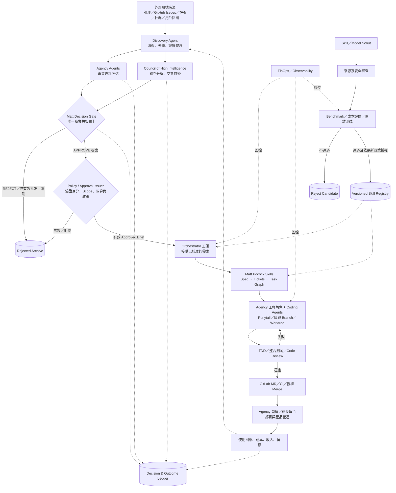
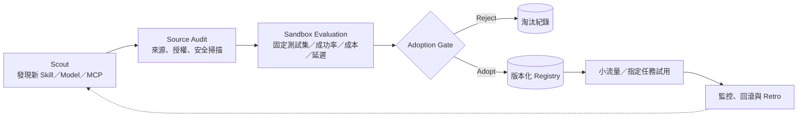

# Autonomous Product Discovery & Delivery System — 系統架構

> 文件性質：概念架構／實作藍圖（尚未表示系統已建置或各工具已完成串接）  
> 版本：v0.2  
> 更新日期：2026-10-21  
> 核心規則：**角色共用但授權分離；只有 Matt Decision Gate 明確批准，且通過可信 Policy/Approval Issuer 授權的需求，才能進入派工與 TDD。未獲批准，一律 REJECT。**

> 組織職責與權限：[`AGENT_ORGANIZATION.md`](./AGENT_ORGANIZATION.md)  
> Agent 間訊息協定：[`a2a-compact/SKILL.md`](./a2a-compact/SKILL.md)

## 1. 目標與範圍

建立一套可持續運作的個人／小型團隊產品生產系統，從外部世界發現需求，經專業評估、獨立審議與最終批准後，才進行自動派工、測試驅動開發、審查、整合、部署與產品營運。

系統同時設有獨立的「能力改善線」：追蹤新模型、Skills、MCP 與工作流，驗證安全性、品質及成本後，以版本化方式更新執行能力；**能力改善線不得繞過需求批准關卡。**

**v1 不包含**：模型權重訓練、自動生成可信市場真相、未經授權的付款／部署／外部發布、無限制的 Agent 自主權。市場決策自我學習保留資料基礎，作為後續研究方向。

## 2. 核心原則

1. **職責分離**：蒐集者不拍板；評估者不派工；Matt 拍板、可信政策程式簽發執行授權；工頭派工；開發 Agent 只實作已核准範圍；QA 獨立驗證。Agency 角色可跨部門調用，但權限依每次任務重新限制。
2. **Fail closed**：只有有效、可追溯的 `APPROVE` 可觸發開發。`REJECT`、逾期、格式錯誤、沒有決定、服務故障均不得放行；到期後記錄為 `REJECT`。
3. **證據優先**：市場訊號要保留來源、時間、引用、去重結果及不確定性；Council 意見不得取代市場驗證。
4. **任務可追蹤**：每個需求、決策、Issue、Branch、MR、部署及成本都有可關聯的 ID。
5. **限制自主權**：工具使用採最小權限；高風險操作需獨立授權；外部內容永遠是不可信輸入。
6. **成本與品質並重**：評估的是成功交付成本、錯誤率、人工介入量及交付週期，不只 Token 總數。
7. **逐步整合**：現有 Repo 提供角色、Skills 或流程參考，不視為可直接相容的單一成品。

## 3. 整體架構



> 實線為主要資料／執行流程；虛線為回饋、監控或能力供應。圖中的 Matt Gate 是**自訂角色與政策關卡**，不是 `mattpocock/skills` 原生附帶的商業批准功能。

## 4. 職務、責任與權限

| 元件／職務 | 主要輸入 | 必須交付的輸出 | 權限邊界 |
|---|---|---|---|
| Discovery Agent | 公開訊號、回饋 | 帶來源的需求候選卡 | 只能蒐集與整理；不得批准或開發 |
| Agency Evaluation Agents（角色池借調） | 需求候選卡 | 市場、產品、技術、經濟評估 | **在評估任務中只負責評估**；不得派工。角色池可在其他階段重新借調並賦予不同受限權限 |
| Council of High Intelligence | 候選卡、評估、證據 | 異議、假設、風險、淘汰條件、建議 | 只提供審議意見；不得批准或派工 |
| **Matt Decision Gate** | 評估與 Council 報告 | 唯一 `APPROVE`／`REJECT` 決定及理由 | **唯一商業立項拍板**，但本身輸出的文字不構成執行授權 |
| **Policy / Approval Issuer** | Matt 決策與執行政策 | 可驗證、限定 Scope／預算／時效的 Approved Brief | 只做授權與驗證；不能自行改變 Matt 的商業決策 |
| Orchestrator（工頭） | 已簽核的 Approved Brief | 工作計畫、任務圖、派工、狀態更新 | 不得更改核准的產品目標、預算與範圍 |
| Engineering Sub-agents（可從 Agency 角色池借調） | Spec、Tickets、Repo | 程式碼、測試、提交、MR | 僅可處理授權任務與隔離工作區；使用 Matt Skills／Ponytail 工程方法 |
| QA／Reviewer | 程式碼、規格、測試結果 | 品質與規格符合性報告 | 可以擋交付；不得重寫商業決策 |
| Skill／Model Scout | 工具來源、執行遙測 | 候選技能、版本、測試提案 | 不可直接修改正式生產環境 |
| Security／Benchmark Gate | 候選 Skill／Model | 准用或淘汰、評測紀錄 | 控制技能登錄，不負責需求拍板 |
| FinOps／Observability | Token、API 費用、執行結果 | 成本、異常、效率、預算告警 | 可依政策限流／暫停；不可自行擴增預算 |
| Product Operations（可從 Agency 角色池借調） | 上線服務與使用者資料 | 監控、客服、轉換／留存／營收指標 | 不得反向覆寫已封存的決策紀錄 |

**注意**：`agency-agents` 提供跨 Discovery、Evaluation、Engineering、Growth、Operations 的**專業角色池**。借調角色時另發新的 Job、Scope、工具憑證；不能因同一角色有跨階段能力，就讓前段評估個體自行轉職開發。完整分工見 [`AGENT_ORGANIZATION.md`](./AGENT_ORGANIZATION.md)。

## 5. 主要工作流（Product Line）

### 5.1 Discovery：需求海巡

- 來源可包含 Reddit、GitHub Issues、產品評論、公開社群、論壇與第一方用戶回饋；遵守各來源的服務條款與存取限制。
- 抽取：原始問題、誰遇到、發生頻率、現在的替代做法（workaround）、目前付出的時間／金錢、既有競品、可能的購買者。
- 保留原始 URL、蒐集時間、原文摘錄、去重指紋與可信度；不能將熱門貼文直接當成已驗證的付費需求。
- 整理為 `Demand Candidate`；資料不足者可在評估前補查，但不能偷渡開發。

### 5.2 Evaluation：Agency + Council

- **Agency**：依專業職責給出市場、產品、技術可行性、成本與商業模式的評估。
- **Council**：對假設進行獨立分析與交叉質疑，保留反對意見、未知項目、淘汰條件與下一個驗證動作。
- 兩者的成果僅是**供 Matt 參考的審議材料**，不得寫入 `APPROVED`、建立可執行的開發 Ticket 或觸發 CI/CD。
- 對資料來源與模型推論分別註記 `FACT`、`INFERENCE`、`ASSUMPTION`、`UNKNOWN`；多個角色達成共識不等於獨立實證。

### 5.3 Matt：唯一決策關卡

`Matt Decision Gate` 是本系統自訂的決策角色／政策，不是 Matt Pocock Repo 現成的商業決策 Skill。必須自行定義使用的模型、規則、決策期限、審計方式及是否有人類覆核。**其輸出的 APPROVE 必須再由可信 Policy/Approval Issuer 簽發可驗證授權，不能只相信模型文字。**

- **APPROVE**：明確記錄批准人／代理身分、版本、範圍、驗收目標、預算上限和決策依據，簽發不可任意修改的 `Approved Brief`。
- **REJECT**：保存拒絕原因與證據，結案，不進入開發。
- **沒有有效決定**：依「沒有拍板就是 Reject」政策記錄為 `REJECT`，而不是自動重試到批准。
- 任何要求擴大原核准範圍的需求，須產生新候選案重新評估與批准。

### 5.4 Dispatch + TDD：批准後才執行

1. Policy/Approval Issuer 驗證 Matt APPROVE 的來源、範圍、預算與政策並簽發 Approved Brief；Orchestrator 再驗證 `Approved Brief` 的狀態、簽章／來源、範圍與預算。
2. 依 `mattpocock/skills` 的精神，選用 `to-spec`、`to-tickets`，把需求拆成可驗收的**垂直切片**及有依賴關係的 Task Graph。
3. 用 `implement-spec` 思路，優先派發不互相阻塞的 Ticket；每個工程 Agent 使用隔離 Branch／Worktree。
4. 工程 Agent 執行 `tdd`（Red → Green → Refactor），並定期執行型別檢查與相關測試；Ponytail 可作為最小完整變更與優先重用現有程式碼的實作原則，不能取代測試與安全檢查。
5. 整合者依順序合併到 Integration Branch；衝突、失敗測試、環境異常回到對應 Ticket 修復。
6. `code-review` 分別確認**規格符合性**和**程式碼品質**；必要時補安全掃描及 E2E 測試。
7. 產生 GitLab MR；只有 CI／Review／權限政策全通過才准 Merge 與部署。
8. 交付後執行 `retro`，記錄可改善的工程流程，不得直接改動需求 Gate。

> `mattpocock/skills` 提供工作流程與方法，不負責代管工作佇列或跨系統持久化；這些由自建 Orchestrator 與資料儲存層處理。Agent 間交接採 [`a2a-compact`](./a2a-compact/SKILL.md) JSON 契約並以程式 Schema 驗證，不重複貼出 Context。

### 5.5 Operations：上線後

紀錄實際部署版本、錯誤率、成本、使用者回饋、使用率、留存、轉換及營收（若適用）。對外發布、付款或不可逆資料操作依風險等級設置授權關卡。營運數據回饋後續 Discovery 與 Decision Ledger，**不覆寫原始決策**。

## 6. 獨立能力改善線（Capability Line）



**來源**：`skills.sh`、`SkillsMP`、`alirezarezvani/claude-skills`、GitHub 原始 Repo、模型供應商官方說明。整合庫屬搜尋入口，不自動構成安全或效能保證。

**可參考的 Skills**：`skill-security-auditor`、`skill-doctor`、`skillopt-sleep`、`agent-memory`、`loop-library`、`retro`、`Tool Evaluator`、`FinOps Engineer`。這些名稱來自不同專案，安裝格式與自動呼叫能力要逐一驗證。

**驗證政策**：

- 第三方內容先在隔離環境讀取及測試，掃描腳本、外連、敏感資料讀取、Prompt Injection 與授權條件。
- 使用固定的代表性任務比較成功率、人工修復量、總成本與端到端延遲；測試失敗時不得因「模型認為比較好」而採納。
- 採用結果鎖定版本（commit SHA／release）、登錄來源與評測證據；支援 Canary、回滾與禁用。
- Agent 的發現／建議權與正式更新權分離；正式導入依既定授權政策執行。
- **不因優化流程就重開被 Matt REJECT 的需求。**

## 7. 狀態機與閘門

### 7.1 需求生命週期

```text
DISCOVERED
  → EVALUATING
  → AWAITING_MATT_DECISION
      ├─ APPROVE → APPROVED → PLANNING → IMPLEMENTING → REVIEWING → DELIVERED → OPERATING
      └─ REJECT / TIMEOUT / INVALID / NO_DECISION → REJECTED (terminal)
```

- 只有 `APPROVED` 且具有有效 `Approved Brief` 的需求可由 Dispatcher 接收。
- `REJECTED` 為終止狀態，不允許重新賦予相同決策 ID；若重新發現新的重大證據，須建立**新的**候選案並保留舊案關聯。
- 已批准但超出成本、權限或風險限制時，工作可進入 `BLOCKED`／`PAUSED`，**不可自行提高預算或擴張範圍**。
- 實作失敗與市場拒絕是不同概念：前者可在原核准範圍內重試，後者不得進入實作。

### 7.2 授權邊界

| 事件 | 必要條件 |
|---|---|
| 建立可執行 Ticket | 有效的 `APPROVE` 與 Approved Brief |
| 呼叫 Coding Agent | Ticket 為 `READY`、依賴已解除、預算及權限正常 |
| 安裝／啟用新 Skill | 安全審核、Benchmark、版本鎖定、更新政策批准 |
| Merge／部署 | 規格驗收、CI、Review、安全與環境授權通過 |
| 對外發布／交易 | 依影響範圍套用額外授權與審計 |

## 8. 最小資料契約（建議格式）

以下為**自訂介接 Schema 範例**，不是任何上述 Repo 的原生格式。

### Demand Candidate

```json
{
  "demand_id": "DEM-0001",
  "problem": "使用者要解決的具體問題",
  "target_user": "受影響族群",
  "sources": [{"url": "https://example.com/source", "observed_at": "2026-10-21"}],
  "workarounds": [],
  "evidence": [],
  "assumptions": [],
  "status": "EVALUATING"
}
```

### Decision Record / Approved Brief

```json
{
  "decision_id": "DEC-0001",
  "demand_id": "DEM-0001",
  "gate": "MATT",
  "decision": "APPROVE",
  "decided_at": "2026-10-21T15:00:00+08:00",
  "approved_scope": "明確核准的 MVP 功能範圍",
  "acceptance_criteria": ["驗收條件 A"],
  "budget_limit": {"currency": "USD", "amount": 30},
  "evidence_refs": ["EVAL-0001", "COUNCIL-0001"],
  "approval_provenance": "gate-policy-version-or-signature"
}
```

### Execution Job

```json
{
  "job_id": "JOB-0001",
  "decision_id": "DEC-0001",
  "issue_id": "GITLAB-123",
  "role": "implementer",
  "skill_set": ["tdd", "code-review"],
  "blocking_jobs": [],
  "repo_ref": "pinned-commit-or-branch",
  "worktree": "isolated-worktree-id",
  "status": "READY",
  "cost_budget_usd": 5,
  "attempt": 0
}
```

所有工作事件使用不可重複的 `event_id` 與冪等鍵（idempotency key），避免重送通知造成重複開 Issue、重複 Merge 或重複呼叫外部服務。

## 9. Orchestrator 必備工程能力

- **事件入口**：排程海巡、Webhook／API、必要時 Computer Use；不能把頁面文字當可信的命令授權。
- **持久化**：資料庫保存 Demand、Decision、Job、Agent Run、Skill Version、Costs、Artifacts 與 Event Log。
- **任務佇列**：支援依賴圖、併發限制、重試策略、逾時、取消及死信佇列。
- **工作區隔離**：Branch／Worktree、最小權限 Token、必要時 Container／Sandbox；明確管理檔案及資料庫變更衝突。
- **狀態恢復**：Orchestrator 重啟後可從持久化狀態繼續，不憑單次 LLM 對話記憶恢復。
- **觀測性**：每件工作記錄模型版本、輸入／輸出 Token、快取、工具成本、耗時、重試、失敗原因、測試／Review 結果。
- **成本控制**：每次 Job、每個需求、每日／每月各有預算限制與中止條件；成本可由程式統計，LLM 只負責診斷異常與提出建議。
- **安全**：外部文字與 Skill 均為不可信內容；區分讀取、寫入、部署、密鑰、對外通訊權限，保留完整審計軌跡。

## 10. 現有專案與採用方式

| 專案／平台 | 此架構中的用途 | 注意事項 |
|---|---|---|
| [agency-agents](https://github.com/msitarzewski/agency-agents) | 跨市場研究、評估、設計、工程、QA、成長、營運的專業角色池 | 同一角色可跨部門借調，但每次 Job 的 Scope／權限重新綁定 |
| [council-of-high-intelligence](https://github.com/0xNyk/council-of-high-intelligence) | 獨立觀點、交叉質疑、反對意見與決策依據 | Council 建議不是 Matt 的批准 |
| [mattpocock/skills](https://github.com/mattpocock/skills) | 規格、拆票、實作調度、TDD、Code Review、Retro | `Matt Decision Gate` 須**自行定義**，不可誤認為此 Repo 內建 |
| [Ponytail](https://github.com/DietrichGebert/ponytail) | 工程層最小完整變更、重用、精簡程式碼與回報 | 不等同於跨 Agent 的結構化通訊協定 |
| [`a2a-compact`](./a2a-compact/SKILL.md) | 本專案自訂 Agent 間 JSON 交接、Artifacts refs、阻塞回報 | 需外部 Schema 驗證和真實授權檢查，Prompt 本身不構成安全邊界 |
| [alirezarezvani/claude-skills](https://github.com/alirezarezvani/claude-skills) | Skill 候選庫、評測、記憶與工作流優化工具 | 整合庫品質不等於每個 Skill 均可靠 |
| [skills.sh](https://skills.sh/) / [SkillsMP](https://skillsmp.com/) | 找 Skill 的索引入口 | 候選都需回溯原始碼並重新驗證 |
| GitLab + GitLab CI/CD | Issues、Branch、MR、Pipeline、部署 | 實際串接依專案權限與環境決定 |
| Codex／Claude Code 等 | 開發工作代理執行環境 | 視實際 CLI、Skill、工具權限支援程度選用 |

## 11. 市場決策的長期學習：目前空缺

短期優化可以透過 Skill 更新、Model Routing、規則、Benchmark、記憶與成本回饋實現，**不需要訓練模型權重**。

但「辨識哪些市場需求值得做」需要真實結果、足夠樣本、因果歸因及延遲回饋；不能只蒐集大量貼文就當成有效訓練資料。此能力標記為 **Future / Research**，不阻擋 v1。

v1 先保存 `Decision Ledger` 與 `Outcome Ledger`：當下的證據、預測、異議、批准／拒絕原因、後續上線結果與驗證時間。注意被拒需求通常沒有直接的產品結果，未來評估需考慮選擇偏差。

## 12. MVP 範圍與建置順序

1. **最小主流程**：用固定的 Demand Candidate 測試資料 → Agency／Council 評估 → Matt APPROVE/REJECT → Reject 結案或 Approved Brief。
2. **封鎖性 Gate**：在 Dispatcher 層實作硬性授權檢查；直接測試 `REJECT`、逾期、格式錯誤、偽造批准、重送事件均**不能**啟動 Coding Agent。
3. **單 Repo 開發閉環**：批准 → Spec → Tickets → Worktree → TDD → Review → GitLab MR → CI；先不追求多 Agent 大規模併發。
4. **海巡接入**：加入至少一個合規的外部需求來源，完整追溯來源、去重與證據。
5. **持續改善線**：候選 Skill 的隔離安全掃描、Benchmark、版本 Registry、可回滾更新。
6. **成本與營運**：Token／工具成本儀表板、異常告警、部署後數據及決策紀錄連結。

### v1 驗收條件

- 任何未核准需求在技術上都**無法**建立可執行派工。
- 已核准需求能產出可追溯的 Spec、Issue、Code、Tests、MR 與部署結果。
- CI／Review 失敗不能跳過品質閘門。
- 任務中斷後可安全恢復，重試不造成重複副作用。
- 每個 Job 有預算上限、可追溯的成本與清楚的停止條件。
- 新 Skill 無法在未經測試與授權下直接進入正式 Registry。
- 決策理由、採用的證據與後續結果可以跨階段關聯查詢。

## 13. 待決定的實作參數

下列項目是明確待選，而非目前已存在的事實：

- Matt Gate 採用的模型、固定評分規則、誰持有最終授權，以及預設決策時限。
- Orchestrator 使用的程式語言、執行框架、資料庫與佇列。
- 海巡來源的授權方式、蒐集頻率、Rate Limit 與保存期限。
- GitLab Project／Runner／Environment 的存取範圍、分支保護與 Merge／部署權限。
- 模型選型、測試資料集、成本上限、是否支援自動回滾。
- 上線產品的分析、客服、付款及隱私保護流程。

---

**一行總結**：**Discovery → Agency 評估 + Council 審議 → Matt（唯一商業拍板）→ Policy/Approval Issuer（執行授權）→ Orchestrator（派工）→ Agency 專業角色 + Matt Skills + Ponytail（TDD／Review）→ GitLab CI/CD → Agency 營運角色**；整個角色池可跨階段借調但權限依 Job 綁定，A2A 訊息採結構化 JSON，旁路由 **Skill/Model Scout + Security/Benchmark + FinOps** 持續改良執行能力，市場決策學習暫列長期研究。


---

> **v0.3 政策補充：** 請以 [`P00-GROUNDED-ANSWER.md`](../policies/P00-GROUNDED-ANSWER.md) 為所有角色必須遵守的全域實證回答規範；其唯一真相來源為 `policies/`，本參考文件不重複政策條文。
