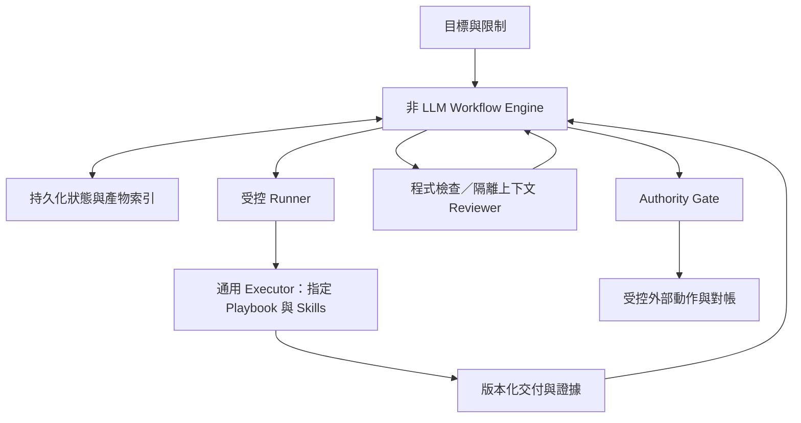

# Playbook MVP 架構建議稿

> 日期：2026-10-27（Asia/Taipei）  
> 狀態：目前的目標架構；實際能力以 [workflow-mvp](../../workflow-mvp/README.md) 與測試證據為準，不是全部已上線或逐項獲准的宣告。  
> 範圍：[端到端執行流程與驗收契約](PLAYBOOK_MVP_EXECUTION_FLOW.md) 補足 Trigger、准入、狀態轉移、交接、授權、恢復與驗收分支。本機 Trigger 與固定測試控制子集已實作，完整模型工作流仍未完成。

## 1. 目標與已確認原則

使用者已確認的原則：

- Playbook-first MVP；先有具體需求，再決定該次工作的交付範圍。
- B 方案：Playbook 不呼叫其他 Playbook；只有非 LLM Engine 管理跨 Playbook 派工與依賴。
- 階段契約明確，階段內方法可調整；交付以下游 Agent 可接手為準。
- 介面設計綜合 UI UX Pro Max＋Taste Skill，理解既有產品與當代參考。
- 審查往返最多兩輪，未解決就重新對齊目標。
- 保存必要文件與紀錄，保留 Proof、Durable Execution、Authority 與 P00。
- 需求可由 Trigger 進入；使用者直接提出的想法不以商業價值作開工門檻，只檢查需求、能力、權限與預算；Agent 主動發現的機會先經商業價值評估，再走相同准入。

本稿其餘部分均為建議預設，包括技術選型、計數方式、試跑門檻及資料組織；不是新增執行授權。缺少需求時保留工作終點，不臆造產品規格。

角色與 Skill 只提供方法，不取得派工或授權權力。Schema 合規也不構成防注入或語意正確的保證。

## 2. 最小拓撲與責任

- **Engine**：唯一寫入正式工作狀態與接受交付的元件；安排固定流程、Script、Gate、查核、補件及停止。
- **Playbook**：定義工作契約與內部階段，輸出成果、缺口或提案，不管理其他 Job。
- **Executor**：使用當次允許的工具完成階段；局部方法選擇不改變契約或權限。
- **Runner**：建立／管理執行環境與 Session，接收停止要求，回報事件及執行證據；模型完成訊息不是 Job 完成授權。
- **Reviewer**：回報可定位的符合項、缺陷與未知，不直接批准發布或改寫原成果。
- **Authority／受控動作路徑**：根據有效授權、Attempt、範圍及資源執行副作用並保存收據。

MVP 先採單一主機、單一控制程式與有界順序執行。獨立審查開隔離上下文；同一 Job 的各階段不各自增加 Agent。無須建立固定部門、常駐角色或通用協商網路。

首次啟動的信任基準是使用者明示的政策與允許範圍，由 Engine 保存並檢查。沒有對應的預授權就等待明確授權；已有預授權的低風險工作按規則自動推進，不每一步重新問人。

## 3. 範圍與需求如何進入

先從需求整理出目標、限制、已有成果、必要決策與可接受的交付終點。非關鍵未知明列假設；會改變方向或授權的歧義才等待可信決策。

驗收契約須回到原始要求核對覆蓋，沿用釘選 Playbook 的必要驗收項。新增或實質改動條件時，在准入前做隔離上下文的有界完整性審查，檢查漏項及條件弱化，綁定來源與契約版本；最多兩輪仍未解就對齊目標。完整沿用已核定範本且只填允許參數時，不每次增加 Reviewer。准入審查與交付驗收分別記輪、共用根預算，不取得額外授權；重大歧義回到可信決策。細節見執行流程第 2 節。

Engine 從已發布且適用的 Playbook 組合固定 Workflow，或依完整既有輸入省略不必要的前置工作。找不到適用契約就回報能力缺口，不自行生成並執行新型工作。

MVP 的動態工作提案只保存為候選；不自動展開成任意新 Workflow。局部探索與 Run Plan 可在原契約內使用，不取得額外預算或派工權。

此處固定的是平台控制能力，不固定每項需求都必須從研究做到發布。平台管理控制台亦不是交付網頁／App 的必然前置。

## 4. Playbook、階段與接手契約

一份 Playbook 對應可獨立委派及驗收的工作，可交付多個相關產物。重要階段包含：目標、必要輸入、最低要求、可調整方法、交付物及完成／停止條件。共用政策只引用，不逐階段複製。

工具、搜尋詞、資料量、細部步驟與有界修正保留彈性；階段依賴、必要交付與驗收條件固定。已有結果經檢查版本、來源與適用性後可重用，不能宣稱重用資料已重新實測。

下游接手包至少能回答：

1. 要解決什麼、範圍及限制是什麼？
2. 正確的輸入與交付版本在哪裡？
3. 哪些決策已確定、哪些是假設或待決？
4. 下一步需要哪些操作、資料與驗收要求？
5. 哪些工作已完成、哪些失敗或未驗證？

Engine 檢查必要參照及契約欄位；下游 Executor 在開始有副作用工作前確認資料足夠。缺關鍵輸入就回報缺口，不能為接手而自行改定需求。

交付形式依下游需要選擇。介面設計可用文字、圖、Tokens、素材或原型的適當組合，不強制每次全做。畫面轉移、操作狀態、資料需求與設計理由須足以實作；靜態畫面的漂亮不能抵銷流程缺失。

## 5. 首次可信度：兩道門檻

### 5.1 可受控試跑

候選 Playbook 尚未證明有效，但滿足以下條件可由既有政策／明確授權允許限定試跑：

- 原始目標、適用範圍、交付、停止條件與資源限制明確。
- 程式可檢查契約結構、版本、必要參照及權限範圍；這只證明可辨識，不證明方法有效。
- 隔離上下文的審查檢查 Proof 是否可能形式通過卻未解決需求，並檢查安全、整合與成本缺口。
- 試跑環境能限制資料、工具與副作用；無法落實控制的能力不列入可用範圍。
- 執行前記錄正常、缺關鍵資訊、應停止／不通過等案例的預期行為。

第一份契約與採用政策由使用者目標及明示政策提供基準，不能讓候選 Playbook 自行宣告有資格授權自己。Reviewer 的評估也是證據之一，無須為每份審查再遞迴建立另一位 Reviewer。

### 5.2 可限定範圍重用

試跑之後檢查實際交付品質、下游接手、來源與推論、正確停止、恢復、安全控制及成本紀錄。安全越界、捏造證據或必要交付缺失不能被加權高分抵銷。

採用紀錄釘選 Playbook、Skills、政策、案例與執行環境版本，列出已測範圍、失敗、成本與不可推廣的限制。既有基準存在時才做同條件比較；沒有基準不宣稱效率提升。

角色指引要求正式部署前有至少 20 個代表案例與回歸檢查。本稿建議將其定位為正式共用版本的起始評測規模；初期受控試跑先覆蓋上述必要情境。兩者資格分開，不能把少量試跑結果當作正式部署通過。

20 是本次引用角色指引的建議下限，不是統計可靠度證明。案例還須涵蓋正常工作、缺資訊、錯誤證據、越權／外部指令、中斷／恢復及兩輪退出；風險或變異較高時增加案例。發布／成本／權限等硬性限制不得為降低評測成本而省略。

## 6. Proof 與審查的判定規則

分開保存：執行結果、契約驗收結果、業務結論。證據不足可能是合格研究的結論；未完成必要查核則不是完整驗收通過。

作者應交付的必要證據經確認缺失或不合格，判本輪 FAIL，適用一次補件及第二輪退出規則；工具、環境、授權或平台查核輸入阻礙判定，才記 UNKNOWN／查核受阻並有界恢復同一 review_id 與指定版本。原因未明不能推定通過或失敗；已確認缺陷不因其他查核受阻而消失，不能在同一輪暗中替換作者成果。

必要項目同時有 FAIL 與查核受阻的 UNKNOWN 時，先保存缺陷並等待恢復同一版本的未完成查核，不先啟動作者補件；受阻解除後才彙整該輪結果。重試次數或期限耗盡則以 `REVIEW_RETRY_EXHAUSTED` 等待可信決策，不自動恢復或重置已用次數；工具恢復或補額度也不解除原上限。可決定維持等待或安全結束，調整固定上限須走契約變更與新 Job 准入，保留原歷史及根額度；細節見執行流程第 6 節。

每個審查缺陷需指出對應要求、指定交付版本／位置、實際觀察、影響及可檢查的改善要求。只有個人喜好且無契約依據的建議，不自動變成阻擋條件。

Executor 可用證據回應；Engine 依固定規則處理可程式判定的部分。語意分歧不能以投票、自評信心或多叫一位 Agent 自動裁決。

**本稿的兩輪計數規格**：初審為第一輪；必要修正後再審為第二輪，最多一次自動語意補件。必要查核不再受阻後，第二輪仍有必要缺陷或未解分歧，停止原補件循環，進入等待目標對齊。這是本次流程補全採用的保守預設，不構成額外預算、發布或擴權授權。

輪次綁定本次工作契約與未解問題，換 Attempt、Session 或 Reviewer 不歸零。預算耗盡、越權或執行不安全時更早停止。工具故障重試另有有界計數，不可藉重新執行內容規避審查上限。

目標對齊包包含原目標、固定驗收、目前成果、雙方證據、分歧、資源與建議。若只是可依現有規則解決的誤讀，按紀錄處理；若需改目標、範圍、驗收或授權，回到使用者或明確被授權的政策主體。等待逾時不視為同意，也不自動派工。

實質改變契約時建立關聯的新 Job，保留原紀錄及資源歷史；原契約的 Proof 不自動轉用，新工作及額度也不會因此自動獲准。

## 7. Runner 選型與最小技術建議

### 7.1 選項與建議

| 選項 | 取捨 |
|---|---|
| 直接包裝非互動 CLI | 起步程式少，但須自行處理程序、事件、錯誤與協定對接；結構化回覆不能代替事件與副作用控制 |
| 官方 SDK | 可沿用供應商的程式化整合；仍須自行落實 Engine、持久化與 Authority |
| 直接整合 app-server 協定 | 對事件與批准流程的控制較直接，也增加連線與協定生命週期的實作責任 |

**本稿建議預設：Python 控制程式＋SQLite＋檔案產物庫＋官方 Python Codex SDK。**

官方文件描述 Python SDK 透過 JSON-RPC 控制本機 app-server，正式 SDK 發布包含釘選的 CLI Runtime；app-server 文件提供執行、事件、批准及中斷介面。此為選型依據，不表示本機版本、帳號與政策已通過整合測試。[S1][S2]

選 Python 是本稿的可維護性取捨：同一語言負責控制、持久化與第一個 Runner。SQLite／檔案庫先服務單主機，不先引進遠端 Queue、向量資料庫、多 Provider 或平台 UI。舊版 SQLite 參考程式可評估重用，但不是新版的權威基線，也不在本次遷移資料。

### 7.2 Runner 的內部契約

Engine 只需要能啟動、觀察及停止有效 Attempt；Runner 對外提供執行識別、工具／進度事件、產物提交、用量及終止證據。正式方法名稱與 Schema 在實作時依 SDK 釘選版本決定，不先自建通用外掛框架。

預設每個 Attempt 用新 Session；同一 Attempt 內可連續執行內部階段。中斷後由新 Attempt 讀恢復包，SDK 的歷史恢復只是可選輔助。Reviewer 使用獨立 Session，接收原始契約與指定交付，不繼承作者整段對話。

Runner 的 thread／turn ID 只是供應商識別，不等於 Job／Attempt。供應商 Session 結束不能刪除 Job 狀態。

Engine 以自己建立的 Runner 連線／執行識別綁定 Attempt，不信任模型自行填入的身分欄位。Reviewer 能寫自己的查核交付，但不能修改被查核產物或其正式驗收狀態。同模型的不同 Session 提供上下文隔離，不保證判斷在統計上獨立。

### 7.3 權限與副作用必須實際生效

- Worker 僅能寫當次工作區。正式 Job 狀態、政策、共用 Playbook 與已接受產物由 Engine 控制，不能只靠提示詞禁止覆寫。
- SDK 的 sandbox 設定須配合明確的檔案及網路權限；指定工作目錄不等於限制全部讀取範圍。實際無法隔離的權限不列為已保障。
- Agent 不持有可繞過平台的 Git／雲端／付費服務長效寫入金鑰。高權限副作用透過受控動作路徑，執行前檢查有效授權、範圍與資源。
- 模型服務認證也不能任意傳入 Worker 的 Shell 或可讀取快取，讓它另啟 CLI／模型工作繞過 Engine 的派工與預算。認證、工具子程序環境與網路出口須隔離並實測；只在 Playbook 寫「不得自行派工」不足以形成控制。
- 外部文件、網站與工具結果是資料來源，不能修改政策、批准動作或派工。有效 JSON 仍可能含惡意內容；結構檢查與權限隔離需分別處理。
- Skills 載入的指令、腳本及 Hooks 須釘選與審查，不因上游更新就自動啟用。瀏覽器測試仍依使用者規範取得該次授權。

Runner 啟動前須核對實際生效的工具、MCP、Hooks 與權限，不能因 SDK 繼承了本機額外設定而默默擴權。未能確認實際能力符合契約就不啟動；此檢查不可繞過使用者或受管理環境的安全規則。

### 7.4 停止不等於退出，也不等於外部操作撤回

依序撤銷受控寫入能力、請求中斷、必要時終止 Runner 程序樹，再驗證相關程序與資源已停止。心跳逾時或 app-server 回報 Turn 結束，不能單獨充當全部子程序退出證明。[S2]

無法證明安全停止時保留「停止中」並隔離工作區，不建立另一個可寫入同一資源的 Attempt；不先刪 Worktree。停止等待可有逾時告警，但不能因逾時自動宣稱已退出。

已送出的外部請求可能仍完成，須繼續對帳。舊 Attempt 回報的操作收據可進入操作稽核，但不能因此覆寫 Job 的有效交付。

## 8. 最小持久化與必要文件

建議 SQLite 保存可交易更新的控制狀態；檔案庫保存較大的不可變產物。Markdown／JSON 交接包是可讀介面，不取代正式狀態與權限檢查。

| 邏輯紀錄 | 必要內容 |
|---|---|
| 工作與依賴 | 根目標、Workflow／Job、輸入與契約版本、依賴、狀態及等待原因 |
| 執行與恢復 | Attempt、Generation、Runner／Session 識別、實際模型與設定版本、租約／心跳、Checkpoint、退出證據 |
| 產物與證據 | Artifact ID、Digest、來源 Attempt、時間、內容位置、必要 Repo／Commit 識別 |
| 審查與對齊 | 查核者、範圍、產物／契約 Digest、結果、缺陷、往返輪次及對齊決定 |
| 授權與操作 | 有效授權參照、範圍、期限、操作識別、請求與收據、對帳／補償狀態 |
| 資源與事件 | 剩餘及已預留資源、實際／估計用量、事件 ID、Trace ID 與關鍵狀態轉移 |

這是邏輯內容，不是要求六張表或六份文件。只保存恢復、追溯與治理需要的資料；長資料以版本化參照載入，必要欄位不能因上下文不足而靜默刪除。交接排除金鑰、非必要敏感資料與模型隱藏推理；保存可查核的決策理由和證據即可。

Artifact 先可靠保存並核對 Digest，再由 Engine 交易式接受並推進狀態。保存檔案與資料庫中途失敗時可能留下孤立檔案，但不能產生缺檔的已接受交付；啟動時可對帳，不把目錄中出現的檔案直接當成完成。

目前 MVP 不提供跨主機高可用或跨 Repo 原子交易保證。資料備份須包含狀態與對應產物；實際保留期限依資料與使用需求設定，不預設永久保存全部原始輸出。

還原舊備份後須凍結受影響派工與外部發送，確認舊執行退出／撤權，並對帳備份之後可能遺失的操作；不能把還原出的 PREPARED／READY 當成未執行證明。須從獨立紀錄、供應商歷史或可信收據重建；無法重建就維持隔離／等待，不盲目重送。完成對帳及一致性檢查後才重新核對授權、資源與執行身分並續行；細節見執行流程第 8 節。

## 9. 狀態、恢復與外部操作

沿用八個 Job 狀態：待執行、執行中、等待中、待驗收、停止中、已完成、已失敗、已取消。目標對齊、缺輸入、缺授權及對帳是等待原因，不新增一個個頂層狀態。

MVP 建議不在等待輸入時保留可寫入的 Worker：先保存 Checkpoint、停止本次執行並確認安全釋放；無法確認則留在停止中並記錄預期等待原因。條件補足後建立新 Attempt，不把已結束的執行重新當作原 Attempt 繼續。

| 情況 | 建議處理 |
|---|---|
| Engine 重啟 | 讀取正式狀態，核對有效 Attempt、存活程序與未決操作；不把所有執行中工作直接重派 |
| Worker 逾時 | 視為需停止／隔離的訊號；確認撤權和退出後才考慮新 Attempt |
| 晚到或重複事件 | 依事件 ID、有效 Generation、預期狀態及交付 Digest 接受或忽略，不重複派工 |
| 缺輸入／授權 | 保存恢復包並等待；不以等待逾時推定同意 |
| 查核工具暫時失敗 | 保留指定版本；有界重試查核，不能改成 PASS 或直接重跑作者工作 |
| 第二輪仍不合格 | 停止原補件循環，保存對齊包，等待可信決策 |
| 結果未知的副作用 | 查詢／對帳；無可靠對帳方式時等待處理，不盲目再送 |
| 必要執行環境缺失 | 保存局部成果與未驗證範圍；必要驗收未完成不能接受完整交付 |
| 取消 | 停止新動作、處理進行中操作並確認 Worker 停止，再標已取消；保留已發生的效果 |

每個有副作用動作先建立操作識別與待執行紀錄。可用供應商冪等鍵時使用；否則保存外部識別並查詢。不能對所有 API 宣稱 exactly-once；補償也是另一次受控操作，不能自動寄信、刪除或退款來掩蓋失敗。

本機狀態可 Fencing 不代表外部 API 已受限。對跨 Repo 的需求，日後仍須獨立固定 Repo／base／Commit、隔離工作區、處理部分成功並對帳，不把單 Repo 測試當成已支援跨 Repo。

## 10. 預算、重試與成本

根目標有總資源額度，Job／Attempt／查核各自使用或預留其中一部分；建立新工作不增加原目標額度。預算不足時先保存可用成果，不讓作者耗盡資源後自動省略必要 QA。

調度前檢查剩餘與已預留額度，工具呼叫前檢查能力及適用限制。限制時間、次數及可觀測 Token；費用依實際供應商用量與價格版本對帳。未知費用記為未知，不當成零；Token 數與帳單不可直接等同。

app-server 文件提供 Token 用量事件，但不據此宣稱具有精確即時費用上限。[S2] 費用延遲、計費模式及進行中請求的超額風險須列明；必要時縮小單次允許範圍、預留餘額或暫停新工作。

工具故障重試採有界次數與退避，與語意補件分開。替代工具／模型只有在既有能力、政策及品質範圍內才使用，記錄版本變化；不能靜默改用另一個模型後沿用舊的品質認證。

## 11. 前端能力整合

介面設計是可選 Playbook 案例，不是通用平台的必經前置。在同一 Playbook 內綜合 UI UX Pro Max＋Taste Skill，形成單一設計交付，不因此增加 Playbook 或 Session。

| 內部階段 | 最低要求與交付 | 完成／停止條件 |
|---|---|---|
| 理解產品與既有介面 | 主要使用者、核心操作、平台、品牌、限制與假設；新產品明記為新設計 | 足以界定設計問題才前進，必要決策缺失則回報等待 |
| 研究當代參考 | 實際相關來源、查看日期、可辨識的發布／版本日期，以及採納與捨棄理由 | 來源不足明列限制，不以舊案例庫或查看日期宣稱當代趨勢 |
| 定義流程與資訊結構 | UI UX Pro Max 的適用流程、導覽、資料與操作狀態要求 | 核心操作及必要狀態可追溯到需求 |
| 綜合視覺方向 | Taste 與 UI UX Pro Max 收斂成同一構圖、Tokens、字體、密度及素材方向 | 支援操作且符合品牌、平台與無障礙限制；重大衝突回報決策 |
| 檢查並交付 | 同版流程、狀態、視覺、參考、取捨、驗收要求與未驗證範圍 | 滿足設計契約才提交；實際操作及獨立 QA 另依適用流程執行 |

階段依賴與最低要求固定；搜尋詞、來源量、工具及交付形式依任務調整，可在既定預算內有界回看。保留 Checkpoint 與提交版本，不以兩份 Skill 累積互相競爭的設計系統。正式執行釘選 Skill 版本，不把行銷網站規則無條件套用到操作介面或原生 App。

新設計從產品情境取材；既有產品優先保留已定品牌與有效模式。參考保留來源、查看日期及適用理由，不能把查看日期當成設計發布日期，也不能只憑固定案例庫宣稱掌握當代風格。

兩份 Skill 共用一套設計規則；流程、無障礙、平台限制及使用者要求不因風格偏好失效。Impeccable 留作後續修整／查核方法，不形成第二套派工權或獨立認證。

需求決定 Web、App 或其他平台；不預設共用所有 UI 程式。交接以工程 Agent 能接手為準，設計交付與工程實作是不同可驗收工作。現有設計足夠時，Engine 可直接安排小幅實作，不強制重跑完整設計。

建置、型別及單元檢查只支持已測範圍。Web 的實際操作、視覺及適用輔助科技檢查，或 App 的模擬器／實機檢查，須分別保存環境與版本證據；缺少必要驗收就記未完成。當前未取得瀏覽器測試授權，不能自動執行。

## 12. 版本治理與外部能力

MVP 的候選整理可以自動化，共用 Playbook／Skill 發布先走受控採用。進行中 Job 固定版本；改善是另一項工作，不在修復當次成果時直接修改正式方法。

更新需保存失敗案例、修改理由、隔離試跑、既有案例回歸、成本差異及採用決定。回滾改變後續 Job 採用的版本，不抹除歷史，也不撤回已發生的外部效果。無法維護或未證實有重用價值的方法不升格為共用 Playbook。

外部能力維持既有定位：anydoc 按需轉換文件，hosted OCR 另處理傳輸授權；claude-mem 僅輔助找回背景；skill-finder 僅發現候選；claude-code-setup 僅提出環境建議。不自動安裝、升級或啟用 Hooks。

## 13. 驗證順序與設計完成的界線

有具體需求後，先固定其輸入、交付終點、權限與資源，再執行：

1. 驗證控制平面與 Runner：啟動、權限拒絕、保存、中斷／退出、舊 Attempt 拒絕與用量識別。
2. 試跑一份適用 Playbook，包含資訊不足與正確停止情境。
3. 接上獨立查核與下游接手，走過第一輪修正及第二輪對齊退出。
4. 注入中斷、事件重送、存檔失敗與外部結果未知，檢查恢復及對帳。
5. 在相同控制能力上重用另一類工作，例如介面設計；只測完成的能力，不推定已支援發布或跨 Repo。

這些是完整工作流的驗收要求；本機固定程序測試只支持控制子集。離線遊戲是目前的真實候選案例，已有手動準備包，尚未由 Engine 准入或執行。

本稿已對剩餘架構議題提供可採行的建議預設。實作前仍須明確接受相關技術及執行範圍；實際能力、帳號可用性、隔離、恢復與費用精度以測試證據為準，不能由紙上討論宣告完成。

## 14. 查核來源與未執行項目

- [S1：OpenAI 官方 Codex SDK 文件](https://learn.chatgpt.com/docs/codex-sdk)：本輪已讀取；支持 SDK 用途、Python SDK 控制本機 app-server、Runtime 釘選及 sandbox 設定的文件描述。
- [S2：OpenAI 官方 app-server 文件](https://learn.chatgpt.com/docs/app-server)：本輪已讀取；支持 thread／turn、事件、批准、中斷及 Token 用量事件的文件描述，不證明本專案已實現隔離與終止。
- [S3：OpenAI 官方命令文件](https://learn.chatgpt.com/docs/developer-commands)：本輪已讀取，與 CLI／app-server 選項比較一併參考。
- [P00 實證政策](../../runtime-reference/policies/P00-GROUNDED-ANSWER.md)：保留程式所釘選的政策原文，不導入其中 B 編號作為新版 API。

SDK 與 app-server 的選型描述是設計依據，未完成模型 Runner 整合。實際測試範圍與未執行項目見 `workflow-mvp/reports/`，不能由文件來源推定本機隔離、帳號資格或完整工作流已驗證。

## 15. 流程補全與規格入口

[Playbook MVP｜端到端執行流程與驗收契約](PLAYBOOK_MVP_EXECUTION_FLOW.md) 是本稿的細部行為規格，與本稿共同構成新版實作依據。[Runtime 參考元件](../../runtime-reference/README.md) 的獨立測試不代替新版驗收。

| 本稿主題 | 補全位置與內容 |
|---|---|
| 需求與固定 Workflow | 流程規格第 2 節：需求／驗收映射、候選計畫准入、重用與略過條件、計畫變更 |
| 責任、狀態與恢復 | 第 3–4、8–9 節：四種生命週期、八個 Job 狀態、交易與競態、停止／恢復、可觀察狀態 |
| 上下游交付 | 第 5 節：各邊界的必要綁定、成功語意、拒絕原因、逾時及恢復 |
| Proof 與兩輪 | 第 6 節：三層判定、不可由作者替換的驗收基準、固定版本、一次補件、重新對齊及接受交易 |
| Authority 與外部操作 | 第 7 節：實際工具／資料／憑證邊界、參數與目標綁定、發送／取消競態、未知結果與對帳 |
| 能力驗證與實作差距 | 第 9–11 節：貫穿案例、23 個分支驗收要求、尚未落實或實測的控制能力 |

流程條款補齊不表示 Runtime 漏洞已被程式修復。實作須依規格逐項提供證據，不能由圖、角色評語或文件完整度宣告可靠性。
